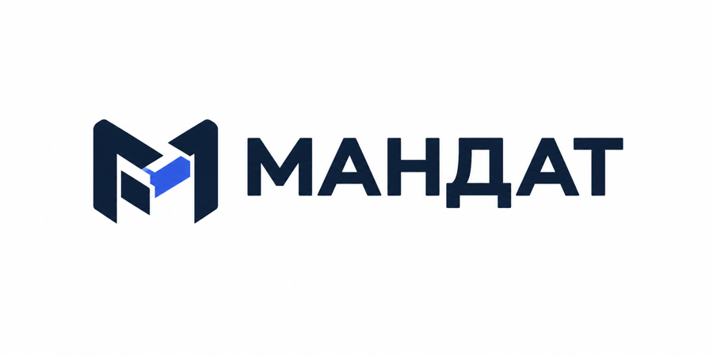
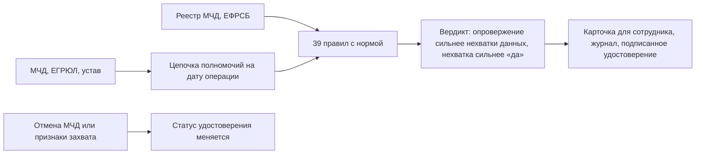

<p align="center">
  
</p>

<p align="center">
  <a href="https://github.com/KonkovDV/Mandat/raw/main/Mandat_VTB.pptx"></a>
  <a href="https://github.com/KonkovDV/Mandat/blob/main/Mandat_VTB.pdf"></a>
</p>

<p align="center">
  <a href="https://github.com/KonkovDV/Mandat/actions/workflows/ci.yml"></a>
  
  <a href="LICENSE"></a>
  <a href="docker-compose.yml"></a>
  
</p>

# Мандат

**Проблема.** Представитель компании приходит в банк с машиночитаемой доверенностью (МЧД). Сотрудник вручную сводит МЧД, выписку ЕГРЮЛ (Единый государственный реестр юридических лиц) и устав и решает, можно ли пустить этого человека к операции. Ошибка в сторону «да» даёт право подписи тому, чьи полномочия уже закончились.

**Что делает «Мандат».** Отвечает на один вопрос: *может ли этот человек провести эту операцию от имени этой компании в этот день?* Ответ выносят правила с привязкой к норме, к каждому приложено, на чём он держится: поле МЧД, запись ЕГРЮЛ, фраза устава, статья закона. Если данных не хватает, «да» не будет.

Проект для трека ВТБ «Финтех без границ: банк будущего для бизнеса и клиентов» соревнования «Академия Финтеха 2026».

## Что уже работает

- **Ни одного ложного «да».** 0 ложных «подтверждено» из 288 кейсов корпуса, где подтверждать нельзя; верхняя граница 95 % — 1,3 % (C-03).
- **38,8 % корпуса решается без человека**, ошибок среди этих решений нет, верхняя граница риска 3,3 % (C-05).
- **39 правил с привязкой к закону:** у каждого статья, следующий шаг для сотрудника и тест (C-01).
- **Журнал, который выдаёт правку:** хеш-цепочка с HMAC и дерево Меркла; аудитор получает доказательство одной записи без всего журнала (C-09).
- **Удостоверение со статусом:** ДБО и антифрод проверяют результат без доступа к базе, отмена МЧД отзывает его по всей цепочке (C-10, C-11).
- **Устойчиво к искажённым входам:** 8814 мутаций сценариев без ложного «подтверждено» и без падений (C-17); свойство передоверия совпадает со второй, независимой реализацией на Cedar на всех 384 цепочках (C-06).
- **Воспроизводимо:** демо одной командой, 585 автотестов, все числа собирает код в `evidence.json` (C-13).

## За 30 секунд



Языковая модель в этой цепочке только предлагает факт из устава с дословной цитатой. Вердикт она не меняет, по умолчанию выключена ([ADR-001](docs/adr/ADR-001-verdict-ownership.md)).

## Четыре ответа

| Ответ | Простыми словами |
|---|---|
| ПОДТВЕРЖДЕНО | Все обязательные проверки пройдены, возражений нет. Сотрудник видит рекомендованную роль и то, что в этом прогоне не проверялось |
| ОПРОВЕРГНУТО | Полномочия нет: например, доверенность отменена или передоверие запрещено. Показаны норма и поле документа |
| НА РАЗБОР | Есть спорное: свежая смена директора, порог в уставе, текстовое полномочие. Решает человек |
| НЕДОСТАТОЧНО ДАННЫХ | Какой-то обязательной проверки не было. Это не «доверенность действует», а список того, чего не хватает |

## Запустить демо

Одна команда, нужен Python 3.11+:

```bash
./run-demo.sh        # Windows: .\run-demo.ps1
```

Скрипт ставит пакет в локальный `.venv` и собирает 14 демо-кейсов в `var/demo/`. Откройте `var/demo/01_ok.html`. Без установки можно посмотреть готовые карточки: [01](docs/demo/01_ok.html), [05](docs/demo/05_director_changed.html), [10](docs/demo/10_old_director_poa.html), [14](docs/demo/14_old_director_charter_cleared.html). Сценарий показа — [docs/DEMO.md](docs/DEMO.md), все команды и API — [docs/RUN.md](docs/RUN.md).

## От стенда к пилоту

Ядро проверки, мониторинг и журнал работают. Пилот подключает к ним источники банка; каждый шаг — адаптер к готовому порту, без переделки ядра.

| Что подключаем | Сейчас | Шаг к пилоту | Кто |
|---|---|---|---|
| Реестр МЧД, ЕГРЮЛ (Единый государственный реестр юридических лиц), ЕФРСБ (реестр сведений о банкротстве) | данные из пакета кейса через порты | адаптеры к сервисам банка или СМЭВ | команда и ИТ банка |
| КЭП (квалифицированная электронная подпись) | порт `SignaturePort`, без СКЗИ статус «не проверено», в `strict` это блокирует «подтверждено» | подключить СКЗИ (средство криптографической защиты информации) банка | ИБ банка |
| Правила | 39 правил в статусе `draft`, у каждого норма | утверждение юристом, [вопросы готовы](docs/LEGAL_REVIEW.md) | юрист банка |
| Формат МЧД | сверен с XSD EMCHD_1 по двум совпадающим открытым копиям | сверка со схемой от оператора реестра | команда |
| Точность на реальном потоке | синтетический корпус с заданными дефектами | 50–100 обезличенных пакетов, теневой режим 6 недель ([пилот](docs/PILOT.md)) | владелец процесса |

Ступени готовности: [docs/audit/READINESS_GATES.md](docs/audit/READINESS_GATES.md), полные границы: [LIMITS.md](LIMITS.md).

## Цифры

Все числа взяты из `evidence.json` (собирается `python scripts/build_evidence.py`) и воспроизводятся командой из [реестра утверждений](CLAIMS_REGISTRY.md). Номер строки реестра — в первом столбце.

| № | Число | Граница |
|---|---|---|
| C-01 | 39 правил, у каждого норма, следующий шаг и тест | все в статусе `draft`, юрист банка их не утверждал |
| C-02 | 14 демо-кейсов, все дают ожидаемый вердикт; «подтверждено» — один (кейс 14) | данные вымышлены |
| C-03 | синтетический корпус: 294 кейса, 49 видов дефектов, совпадение 294 из 294 | дефекты заложили мы сами; это проверка логики, а не точность на документах банка |
| C-03 | ложных «подтверждено» 0 из 288 кейсов, где подтверждать нельзя; верхняя граница 95 % (Уилсон) — 1,3 % | та же синтетика |
| C-05 | без человека решается 38,8 % корпуса, ошибок среди них нет (верхняя граница 3,3 %) | в профиле `strict` доля 0 %: без подписи и утверждённых правил всё уходит человеку |
| C-06 | передоверие не шире родительской МЧД на всех 384 двухзвенных цепочках; вторая, независимая реализация правил на языке политик Cedar даёт те же решения | перебор малого домена, а не доказательство для любых входов |
| C-13 | 585 автотестов проходят | — |
| C-17 | 8814 мутаций сценариев: ложных «подтверждено» и падений нет | мутации построены от наших базовых сценариев |
| C-14 | проверка одного кейса — около 2 мс (медиана), 95 % кейсов быстрее 3 мс | машина разработчика, без сети и модели; на другой машине числа другие |

## Трудные вопросы

| Вопрос | Короткий ответ | Где подробно |
|---|---|---|
| 294 из 294 — это точность 100 %? | Нет. Это совпадение с дефектами, которые мы сами заложили в генератор. Точность на потоке банка не измерялась | [оценка](docs/EVALUATION.md) |
| Почему в демо одно «подтверждено»? | Так задумано: при любом сомнении кейс идёт человеку. Цель — ни одного ложного «да». На корпусе без человека решается 38,8 % кейсов, и среди них ошибок нет | [оценка](docs/EVALUATION.md) |
| Реестр ФНС уже показывает статус МЧД. Зачем вы? | Статус реестра — одно правило из 39. Рядом смена руководителя, передоверие, сроки, устав и покрытие конкретной операции | [конкуренты](docs/COMPETITORS.md) |
| Решение принимает ИИ? | Нет. Вердикт выносят правила, модель только предлагает цитату из устава, без цитаты факта нет | [ADR-001](docs/adr/ADR-001-verdict-ownership.md), [риски ИИ](docs/AI_RISKS.md) |
| КЭП проверяется? | Через СКЗИ банка: порт `SignaturePort` готов. Пока СКЗИ не подключено, статус подписи — «не проверено», и в `strict` «подтверждено» не выдаётся | [границы](LIMITS.md#внешние-системы) |
| Формат МЧД сверен с официальной схемой? | С XSD EMCHD_1 (ГНИВЦ ФНС) по двум открытым копиям с одинаковым хешем. На сайте ФНС эта схема не опубликована, поэтому к пилоту сверяем её с оператором реестра. Теги вынесены в файл соответствия, правка без изменения кода | [формат](docs/FORMAT_NOTES.md) |
| Кто отвечает за правила юридически? | Юрист банка: все 39 правил подготовлены как черновики со ссылкой на норму и вопросами к нему. До утверждения `strict` не выносит по ним ни «да», ни «нет» | [вопросы юристу](docs/LEGAL_REVIEW.md), [трассировка норм](docs/audit/LEGAL_TRACEABILITY.md) |
| Смена директора гасит доверенности? | Нет (п. 1 ст. 188 ГК РФ). Давняя смена — сигнал, свежая — повод для разбора | [ADR-002](docs/adr/ADR-002-director-change.md), [нормы](docs/REGULATORY.md) |
| Персональные данные, 152-ФЗ? | Ядро не ходит во внешнюю сеть. ИНН, СНИЛС, паспорт, телефон и почта заменяются псевдонимами только перед отправкой текста в модель; ФИО не маскируются. Оценку соответствия не проходили | [защита данных](docs/DATA_PROTECTION.md) |
| Удостоверение — это ГОСТ-подпись или W3C VC (проверяемое цифровое удостоверение по стандарту консорциума W3C)? | Модель данных W3C VC 2.0 с подписью Ed25519 по образцу Data Integrity и статусами по W3C Bitstring Status List. В пилоте подпись меняется на ГОСТ через СКЗИ банка; совместимость с внешними верификаторами VC не проверялась | [границы](LIMITS.md#безопасность-и-защита-данных) |
| Откуда экономический эффект? | Данные Банка России о хищениях и число клиентов ВТБ взяты из открытых источников. Доли событий, минуты на кейс и долю ВТБ мы задали сами, источника у них нет. Поэтому это сценарии, а не прогноз | [экономика](docs/ECONOMICS.md), C-15 и C-16 в [реестре](CLAIMS_REGISTRY.md) |
| Почему демо-кейс «01_ok» не «подтверждено»? | МЧД, ЕГРЮЛ и представитель сходятся, но шаблоны не смогли сказать, есть ли в уставе ограничения. Для подписи платежей устав обязателен, поэтому без разобранного устава «да» не будет и кейс идёт человеку (правило R-CHR-002) | [сценарий показа](docs/DEMO.md), [правила](docs/RULES.md) |
| Что будет, если реестр МЧД не ответил? | «Недостаточно данных», а не «действует». Молчание источника не считается хорошей новостью | [границы](LIMITS.md#внешние-системы) |
| Чем это отличается от правил в автоматизированной банковской системе (АБС)? | У каждого вывода есть норма и поле документа, свойство передоверия перепроверено независимой реализацией, решение записано в журнал и выдаётся удостоверением с отзывом | [конкуренты](docs/COMPETITORS.md) |
| Что нужно от банка для пилота? | Владелец процесса, регламент одной операции, 50–100 обезличенных пакетов, выгрузка классификатора, юрист для утверждения правил | [пилот](docs/PILOT.md) |

## Карта документов

| Документ | О чём |
|---|---|
| [docs/DEMO.md](docs/DEMO.md) | сценарий показа, фразы и словарик экрана |
| [CLAIMS_REGISTRY.md](CLAIMS_REGISTRY.md) | каждое число и утверждение с командой проверки и границей |
| [LIMITS.md](LIMITS.md) | границы стенда и что добавляет пилот |
| [docs/RUN.md](docs/RUN.md) | установка, все команды CLI, HTTP API, переменные окружения |
| [docs/MVP.md](docs/MVP.md) | каркас продукта: требования, сценарии, критерии готовности |
| [docs/ARCHITECTURE.md](docs/ARCHITECTURE.md) | как устроен движок по шагам |
| [docs/RULES.md](docs/RULES.md) | все правила: норма, эффект, тест (генерируется) |
| [docs/REGULATORY.md](docs/REGULATORY.md) | нормы и их статус на октябрь 2026 |
| [docs/EVALUATION.md](docs/EVALUATION.md) | как измеряем и что значат цифры корпуса |
| [docs/COMPETITORS.md](docs/COMPETITORS.md) | кто на рынке что делает |
| [docs/PILOT.md](docs/PILOT.md), [docs/ROADMAP.md](docs/ROADMAP.md) | план пилота и дальнейшие шаги |
| [docs/ECONOMICS.md](docs/ECONOMICS.md) | расчёт эффекта и его допущения |
| [SECURITY.md](SECURITY.md), [docs/THREAT_MODEL.md](docs/THREAT_MODEL.md) | безопасность и модель угроз |
| [docs/audit/AUDIT.md](docs/audit/AUDIT.md) | аудит октября 2026: найденное, исправленное, открытое |
| [docs/README.md](docs/README.md) | все документы по ролям читателя |
| [CHANGELOG.md](CHANGELOG.md) | история изменений |

## Лицензия

MIT, © 2026 Коньков Дмитрий. Организации, ИНН и люди в демо вымышлены.
