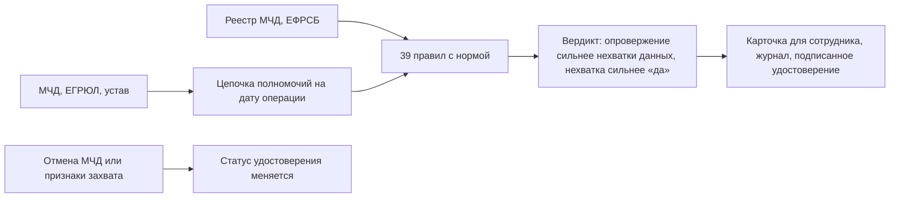

<p align="center">
  
</p>

<p align="center">
  <a href="https://github.com/KonkovDV/Mandat/raw/main/submission/slides/Mandat_VTB.pptx"></a>
  <a href="https://github.com/KonkovDV/Mandat/blob/main/submission/slides/Mandat_VTB.pdf"></a>
</p>

<p align="center">
  <a href="https://github.com/KonkovDV/Mandat/actions/workflows/ci.yml"></a>
  
  <a href="LICENSE"></a>
  <a href="docker-compose.yml"></a>
  
</p>

# Мандат

**Проблема.** Представитель компании приходит в банк с машиночитаемой доверенностью (МЧД). Сотрудник вручную сводит МЧД, выписку ЕГРЮЛ (Единый государственный реестр юридических лиц) и устав и решает, можно ли пустить этого человека к операции. Ошибка в сторону «да» даёт право подписи тому, чьи полномочия уже закончились.

**Что делает «Мандат».** Отвечает на один вопрос: *может ли этот человек провести эту операцию от имени этой компании в этот день?* Ответ выносят правила с привязкой к норме, к каждому приложено, на чём он держится: поле МЧД, запись ЕГРЮЛ, фраза устава, статья закона. Если данных не хватает, «да» не будет.

На GitHub одна ветка, `main`. Значок CI сверху горит зелёным. Карточка сотрудника собирается одной командой: норма, поле документа и следующий шаг. Проверка, безопасность и вклад — [SECURITY.md](SECURITY.md), [CONTRIBUTING.md](CONTRIBUTING.md).

<p align="center">
  <a href="docs/demo/05_director_changed.html"></a><br>
  <sub>Карточка сотрудника из <code>./run-demo.sh</code>: свежая смена директора, вердикт «на разбор», норма и поле документа. Жюри: <a href="docs/JURY.md">питч, сценарий демо и трудные вопросы</a>.</sub>
</p>

## Что уже работает

- **Ни одного ложного «да»:** 0 из 288 кейсов, где подтверждать нельзя. Верхняя граница риска — 1,3 % (C-03).
- **38,8 % корпуса решается без человека**, ошибок среди этих решений нет, верхняя граница риска 3,2 % (C-05).
- **39 правил с привязкой к закону:** у каждого статья, следующий шаг для сотрудника и тест (C-01).
- **Журнал, который выдаёт правку:** хеш-цепочка с HMAC и дерево Меркла; аудитор получает доказательство одной записи без всего журнала (C-09).
- **Удостоверение со статусом:** любую систему банка, например ДБО или антифрод, можно научить проверять его без доступа к базе; отмена основной МЧД отзывает удостоверения по всей цепочке (C-10, C-11).
- **8814 мутаций сценариев:** ложных «подтверждено» и падений нет (C-17); свойство передоверия совпадает со второй, независимой реализацией на Cedar на всех 384 цепочках (C-06).
- **Воспроизводимо:** демо одной командой, 1491 автотест, все числа собирает код в `evidence.json` (C-13).

## За 30 секунд



Слово за правилами. Модель, если её позвать, приносит факт из устава и дословную цитату ([ADR-001](docs/adr/ADR-001-verdict-ownership.md)).

## Четыре ответа

| Ответ | Простыми словами |
|---|---|
| ПОДТВЕРЖДЕНО | Все обязательные проверки пройдены, возражений нет. Сотрудник видит рекомендованную роль и карту этого прогона |
| ОПРОВЕРГНУТО | Полномочия нет: например, доверенность отменена или передоверие запрещено. Показаны норма и поле документа |
| НА РАЗБОР | Есть спорное: свежая смена директора, порог в уставе, текстовое полномочие. Решает человек |
| НЕДОСТАТОЧНО ДАННЫХ | Какой-то обязательной проверки не было. Это не «доверенность действует», а список того, чего не хватает |

## Что не становится «да»

Даже если остальные проверки сходятся, «подтверждено» не ставится, когда:

- устав обязателен, а шаблоны закрыли только часть текста (R-CHR-002);
- от одной МЧД в один день выданы разные передоверия (R-SUB-009);
- в МЧД нет признака совместных полномочий, в том числе у одного представителя (R-JNT-001);
- у кода полномочия в классификаторе нет даты начала (R-COV-002);
- реестр опрошен после даты операции, а в снимке нет даты отмены (R-REG-001);
- в защищённом режиме список статусов проверен без момента времени.

Сомнение остаётся у человека. На карточке — норма и поле документа.

## Что видит модель

Модель зовут по желанию. Она приносит факт из устава и цитирует его дословно.

В запрос попадают только строки о полномочиях. Перед этим текст чистят. ФИО из кейса становятся ролью. Чужая фамилия сразу после «заявлению» или «гражданина» становится меткой, даже если её нет в словаре. Дата рождения и домашний адрес вырезаются. Паспорт, СНИЛС, ИНН и телефон становятся псевдонимами, в том числе если их записали с пробелами, дефисами, точками или со словом «номер». У СНИЛС и ИНН при этом должно сойтись контрольное число, а разорванный ИНН узнаётся только рядом со словом «ИНН».

Сумма в уставе остаётся. «Сделки свыше 1 000 000 руб.» и «8.100.000 рублей» модель должна видеть, иначе она не процитирует порог сделки. «2024 номер 123456» — номер договора, не паспорт.

Формы записи — [защита данных](docs/DATA_PROTECTION.md).

## Запустить демо

Одна команда, нужен Python 3.11+:

```bash
./run-demo.sh        # Windows: .\run-demo.ps1
```

Скрипт ставит пакет в локальный `.venv` и собирает 14 демо-кейсов в `var/demo/`. Откройте `var/demo/01_ok.html`. Без установки можно посмотреть готовые карточки: [01](docs/demo/01_ok.html), [05](docs/demo/05_director_changed.html), [10](docs/demo/10_old_director_poa.html), [14](docs/demo/14_old_director_charter_cleared.html). Сценарий показа — [docs/DEMO.md](docs/DEMO.md), все команды и API — [docs/RUN.md](docs/RUN.md).

### В Docker

```bash
cp .env.example .env
# в .env: MANDAT_ENV=demo и MANDAT_API_TOKEN=<длинный случайный токен>
docker compose up --build
curl http://127.0.0.1:8000/health
```

Без `MANDAT_ENV` compose не стартует. В `pilot` и `prod` нужны ещё `MANDAT_JOURNAL_KEY` и `MANDAT_PII_KEY` (по 32 байта и длиннее, см. [docs/KEYS.md](docs/KEYS.md)).

### Пилотный оверлей compose (проверка конфигурации)

```bash
docker compose -f docker-compose.yml -f deploy/compose.pilot.yml up --build --wait
curl http://127.0.0.1:8000/readyz   # 200 только если журнал, хранилище и ключи в порядке; иначе 503
```

Оверлей кладёт `/app/var` на постоянный том, ставит `MANDAT_ENV=pilot` и проверяет готовность по `/readyz`. `/health` показывает, что процесс жив. Журнал и хранилище пишутся каждый своим шагом.

## Банк подключается к готовому ядру

Проверка, мониторинг и журнал уже на месте. Реестр МЧД, ЕФРСБ и подпись садятся на готовые порты, выписка ЕГРЮЛ — на такой же новый. Ядро остаётся собой.

- **Реестры.** Порты МЧД и ЕФРСБ уже принимают пакет, выписка ЕГРЮЛ ложится тем же движением.
- **Подпись.** `SignaturePort` ждёт СКЗИ банка. Пока подпись не подтверждена, «да» не звучит.
- **Правила.** 39 правил, у каждого норма и следующий шаг. Юрист банка закрывает [вопросы](docs/LEGAL_REVIEW.md).
- **Формат.** МЧД сверена с XSD EMCHD_1 по двум открытым копиям с одним хешем.
- **Корпус.** 294 кейса с известным дефектом гоняют логику. Дальше — [пилот](docs/PILOT.md).

## Цифры

Все числа взяты из [`evidence.json`](evidence.json) (собирается `python scripts/build_evidence.py`) и воспроизводятся командой из [реестра утверждений](CLAIMS_REGISTRY.md). Номер строки реестра — в первом столбце.

| № | Число |
|---|---|
| C-01 | 39 правил, у каждого норма, следующий шаг и тест |
| C-02 | 14 демо-кейсов, все дают ожидаемый вердикт; «подтверждено» — один (кейс 14), остальные бережёт человек |
| C-03 | 294 кейса, 49 видов дефектов, совпадение 294 из 294 |
| C-03 | ложных «подтверждено» 0 из 288; верхняя граница 95 % — 1,3 % |
| C-05 | без человека решается 38,8 % корпуса, ошибок среди них нет |
| C-06 | передоверие не шире родительской МЧД на всех 384 цепочках; Cedar даёт те же решения |
| C-13 | 1491 автотест проходят |
| C-17 | 8814 мутаций сценариев: ложных «подтверждено» и падений нет |
| C-14 | проверка одного кейса — около 2 мс, 95 % кейсов быстрее 3 мс |

## Трудные вопросы

| Вопрос | Короткий ответ | Где подробно |
|---|---|---|
| 294 из 294 — это точность 100 %? | 294 из 294: каждый дефект, который корпус принёс с собой, пойман | [оценка](docs/EVALUATION.md) |
| Почему в демо одно «подтверждено»? | Сомнение идёт человеку. Цель — ни одного ложного «да». Без человека закрывается 38,8 % корпуса, и среди этих решений ошибок нет | [оценка](docs/EVALUATION.md) |
| Реестр ФНС уже показывает статус МЧД. Зачем вы? | Статус реестра — одно правило из 39. Рядом смена руководителя, передоверие, сроки, устав и покрытие конкретной операции | [конкуренты](docs/COMPETITORS.md) |
| Решение принимает ИИ? | Нет. Вердикт выносят правила, модель только предлагает цитату из устава, без цитаты факта нет | [ADR-001](docs/adr/ADR-001-verdict-ownership.md), [риски ИИ](docs/AI_RISKS.md) |
| КЭП проверяется? | Порт `SignaturePort` готов к СКЗИ банка. Пока подпись не подтверждена, `strict` не говорит «да» | [границы](LIMITS.md#внешние-системы) |
| Формат МЧД сверен с официальной схемой? | С XSD EMCHD_1 по двум открытым копиям с одним хешем. Теги лежат в файле соответствия, правка не трогает код | [формат](docs/FORMAT_NOTES.md) |
| Кто отвечает за правила юридически? | Юрист банка. У каждого из 39 правил уже есть норма и список вопросов. Профиль `strict` бережёт «да», пока правило не принято | [вопросы юристу](docs/LEGAL_REVIEW.md), [трассировка норм](docs/audit/LEGAL_TRACEABILITY.md) |
| Кто отвечает, если «Мандат» скажет «подтверждено»? | Банк решает по своему регламенту, «Мандат» собирает карточку. Код исполняет правило так, как оно записано: это держат автотесты. На карточке норма и поле документа, в журнале запись, которую нельзя незаметно поправить | [журнал](docs/ARCHITECTURE.md) |
| Что делает профиль `strict`? | Показывает все возражения и пробелы по кейсу. «Да» без принятого правила становится «не проверено», «нет» уходит человеку. Сомнение не превращается в подтверждение | [правила](docs/RULES.md) |
| Как система узнает об отмене доверенности у нотариуса? | «Мандат» смотрит реестр МЧД ФНС. Отмена у нотариуса и публикация по ст. 189 ГК РФ подключаются отдельным источником | [нормы](docs/REGULATORY.md) |
| Смена директора гасит доверенности? | Нет (п. 1 ст. 188 ГК РФ). Давняя смена — сигнал, свежая — повод для разбора | [ADR-002](docs/adr/ADR-002-director-change.md), [нормы](docs/REGULATORY.md) |
| Персональные данные, 152-ФЗ? | Ядро не ходит во внешнюю сеть. В модель уходят строки устава о полномочиях: ФИО становятся метками, дата рождения и адрес человека вырезаются, номера становятся псевдонимами. Сумма сделки остаётся. Фамилия без подсказки может остаться | [что видит модель](#что-видит-модель), [защита данных](docs/DATA_PROTECTION.md) |
| Удостоверение — это ГОСТ-подпись или W3C VC? | Удостоверение собрано по модели W3C VC 2.0: подпись Ed25519 и статус по списку битов. В банке подпись встаёт на ГОСТ через СКЗИ | [ключи](docs/KEYS.md) |
| Откуда экономический эффект? | Открытые цифры Банка России и число клиентов ВТБ. Поверх них сценарии: доли событий, минуты на кейс, доля банка | [экономика](docs/ECONOMICS.md) |
| Почему демо-кейс «01_ok» не «подтверждено»? | МЧД, ЕГРЮЛ и представитель сходятся. Для платежа нужен разобранный устав: пока его нет, кейс идёт человеку (R-CHR-002) | [сценарий показа](docs/DEMO.md) |
| Что будет, если реестр МЧД не ответил? | «Недостаточно данных», а не «действует». Молчание источника не считается хорошей новостью | [границы](LIMITS.md#внешние-системы) |
| Чем это отличается от правил в автоматизированной банковской системе (АБС)? | У каждого вывода есть норма и поле документа, свойство передоверия перепроверено независимой реализацией, решение записано в журнал и выдаётся удостоверением с отзывом | [конкуренты](docs/COMPETITORS.md) |
| Что нужно от банка для пилота? | Владелец процесса, регламент одной операции, 50–100 обезличенных пакетов, выгрузка классификатора, юрист для утверждения правил | [пилот](docs/PILOT.md) |

## С чего начать

| Вы | Читайте |
|---|---|
| Разработчик | [docs/RUN.md](docs/RUN.md), [docs/ARCHITECTURE.md](docs/ARCHITECTURE.md), [CONTRIBUTING.md](CONTRIBUTING.md) |
| Юрист банка | [docs/RULES.md](docs/RULES.md), [docs/LEGAL_REVIEW.md](docs/LEGAL_REVIEW.md), [LIMITS.md](LIMITS.md) |
| Информационная безопасность | [SECURITY.md](SECURITY.md), [docs/THREAT_MODEL.md](docs/THREAT_MODEL.md), [docs/KEYS.md](docs/KEYS.md) |
| Жюри | [docs/JURY.md](docs/JURY.md), [docs/DEMO.md](docs/DEMO.md), [CLAIMS_REGISTRY.md](CLAIMS_REGISTRY.md) |
| Руководитель | [docs/MVP.md](docs/MVP.md), [docs/PILOT.md](docs/PILOT.md), [CLAIMS_REGISTRY.md](CLAIMS_REGISTRY.md) |


## Карта документов

Сначала три файла: этот, [реестр утверждений](CLAIMS_REGISTRY.md) и [границы](LIMITS.md). Остальное — по роли.

| Документ | О чём |
|---|---|
| [docs/JURY.md](docs/JURY.md) | питч на 3 минуты, сценарий демо, трудные вопросы |
| [docs/DEMO.md](docs/DEMO.md) | фразы показа и словарик экрана |
| [docs/RUN.md](docs/RUN.md) | установка, команды, API |
| [docs/ARCHITECTURE.md](docs/ARCHITECTURE.md) | как устроен движок |
| [docs/RULES.md](docs/RULES.md) | все правила: норма, эффект, тест |
| [docs/DATA_PROTECTION.md](docs/DATA_PROTECTION.md) | что видит модель и какие номера становятся псевдонимами |
| [docs/SOTA.md](docs/SOTA.md) | практика 2026 года |
| [docs/LEGAL_REVIEW.md](docs/LEGAL_REVIEW.md) | вопросы юристу банка |
| [docs/PILOT.md](docs/PILOT.md) | шесть недель рядом с процессом банка |
| [SECURITY.md](SECURITY.md) | защита и ключи |
| [docs/README.md](docs/README.md) | все документы, аудиты и исследования |
| [CHANGELOG.md](CHANGELOG.md) | история изменений |

## Лицензия

MIT, © 2026 Коньков Дмитрий. Организации, ИНН и люди в демо вымышлены.
