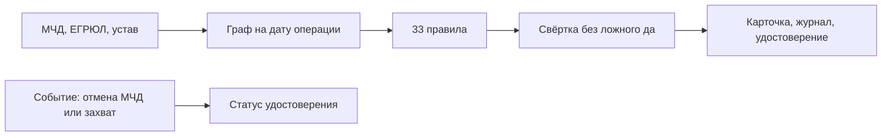

<p align="center">
  <a href="https://github.com/KonkovDV/Mandat/raw/main/Mandat_VTB.pptx"></a>
  <a href="https://github.com/KonkovDV/Mandat/blob/main/Mandat_VTB.pdf"></a>
</p>

<p align="center">
  <a href="https://github.com/KonkovDV/Mandat/actions/workflows/ci.yml"></a>
  
  <a href="LICENSE"></a>
  <a href="docker-compose.yml"></a>
  
</p>

# Мандат

**Единое окно полномочий для бизнес-клиентов банка.** Система отвечает на один вопрос: *вправе ли этот человек провести эту операцию от имени этой компании на эту дату?*

Ответ всегда один из четырёх — **ПОДТВЕРЖДЕНО**, **ОПРОВЕРГНУТО**, **НА РАЗБОР**, **НЕДОСТАТОЧНО ДАННЫХ** — и к каждому приложены доказательства: поле МЧД, запись ЕГРЮЛ с ГРН, фрагмент устава, применённая норма. Если данных не хватает, «Мандат» не говорит «да»: он называет недостающий документ и подразделение, которое ведёт кейс.

Трек ВТБ «Финтех без границ», Академия Финтеха 2026. Сейчас это вертикальный срез на вымышленных данных. Что уже считается, а что заглушка, написано ниже и на плашке «Режим стенда» в каждом отчёте.

**Для жюри:** [сценарий показа](docs/DEMO.md) · [реестр утверждений](CLAIMS_REGISTRY.md) · [границы](LIMITS.md) · [конкуренты](docs/COMPETITORS.md) · [аудит, октябрь 2026](docs/AUDIT_2026-10.md) · [карта документов](docs/README.md)

## Коротко

- **Что делает.** Собирает цепочку «руководитель по ЕГРЮЛ → МЧД → передоверие → представитель» на дату операции и сворачивает 33 правила в один вердикт с доказательствами.
- **Что уже работает.** Двенадцать демо-кейсов, HTML-карточка, журнал с доказательством включения записи, удостоверение со статусом отзыва и приостановки, мониторинг отмены МЧД и признаков захвата. Запуск — одна команда.
- **Что измерено.** На синтетическом корпусе правила совпадают с заложенным дефектом; ложных «подтверждено» в этом корпусе нет. Это проверка логики, не точность на документах банка. Номера утверждений — C-03…C-06 в [реестре](CLAIMS_REGISTRY.md).
- **Чего нет.** Живого реестра ФНС, сверки КЭП по ГОСТ, утверждения правил юристом банка, кодов классификатора из ЕСНСИ. Права в интернет-банке не выдаются: на пилоте режим теневой, система только рекомендует роль.
- **Как запустить.** Windows: `.\run-demo.ps1`. Дальше открыть `var\demo\01_ok.html`, `10_old_director_poa.html` и `05_director_changed.html`.

## Задача банка

Сотрудник операционного блока сам сводит МЧД, выписку ЕГРЮЛ и устав. При сомнении клиента зовут в офис. Ошибка в одну сторону — лишний отказ. Ошибка в другую — право у человека, у которого полномочия уже оборвались.

С 1 сентября 2024 года представитель юридического лица подписывает своей квалифицированной подписью и машиночитаемой доверенностью. С 1 февраля 2026 года действуют новые требования к реквизитам. Проверять нужно не «файл приложен», а всю цепочку на дату: кто выдал, был ли он руководителем, можно ли было передоверить, не шире ли объём, не отменена ли основная доверенность, покрывает ли полномочие эту операцию.

Операторы ЭДО выпускают и хранят МЧД. Сервисы проверки контрагентов отвечают, кто руководитель сейчас. Продукта, который сводит оба слоя с уставом и нормой в объяснимый вердикт на дату и не говорит «да» при пустых данных, в открытых источниках не найдено. Разбор — [конкуренты](docs/COMPETITORS.md).

## Четыре ответа

| Вердикт | Когда | Что видит сотрудник |
|---|---|---|
| ПОДТВЕРЖДЕНО | Обязательные группы проверок закрыты подтверждением, опровержений нет | Рекомендация роли в теневом режиме и сильнейшее возражение: что в этом прогоне не проверялось |
| ОПРОВЕРГНУТО | Хотя бы одно правило опровергает полномочие | Норма, поле документа и следующий шаг |
| НА РАЗБОР | Есть спорное: свежая смена руководителя, текстовое полномочие, порог устава, совместная подпись | Маршрут и срок. Решение остаётся у человека |
| НЕДОСТАТОЧНО ДАННЫХ | Обязательная проверка не выполнена или реестр недоступен | Какого документа не хватает. Это не «доверенность действует» |

Правила решают, языковая модель советует. Без дословной цитаты из устава факт модели не засчитывается, а вердикт она не меняет. Пояснение, которое говорит «подтверждено», цитируя опровержение, отбрасывается. Автоматический вердикт можно оспорить: кейс уходит человеку, основание обязательно. Это в логике Кодекса этики в сфере ИИ, к которому ВТБ присоединился в августе 2026 года.

## Как устроено



| Шаг | Что делает | Где решение |
|---|---|---|
| Приём | XML через защиту от бомб и внешних сущностей. Битый документ становится «недостаточно данных», а не падением | `intake/` |
| Граф | Путь от представителя к руководителю, который выдал корневую МЧД. Цикл в ссылках обрывается | `domain/graph.py` |
| Правила | Норма, статус и текст следующего шага лежат в JSON. Новое правило без теста не проходит сборку | `data/rules.json`, [каталог](docs/RULES.md) |
| Свёртка | Опровержение сильнее недостатка данных, недостаток данных сильнее разбора, разбор сильнее подтверждения. Тишина в обязательной группе — не успех | `domain/verdict.py` |
| Вторая свёртка | Тот же ответ считает отдельный код. Расхождение роняет тест, а не выбирает ответ молча | `domain/verdict_oracle.py` |
| Доказательство | Находка без ссылки на источник не публикуется. Одинаковый вход даёт одинаковый хеш отчёта | `domain/model.py` |
| После выдачи | Отмена основной МЧД переводит удостоверения цепочки в «отозвано». Признаки захвата приостанавливают удостоверения организации. Права в интернет-банке при этом не меняются | `services/monitoring.py` |

Нормы, на которые опирается срез: смена руководителя доверенность не прекращает (п. 1 ст. 188 ГК РФ) — давняя смена сигнал, свежая повод для разбора; отмена основной МЧД обрывает передоверие (п. 3 ст. 188); без срока МЧД действует год (ст. 186); реквизиты — по Приказу Минцифры № 1001. Подробности и оговорки — [нормативная база](docs/REGULATORY.md).

## Слова на экране

| Слово | Смысл |
|---|---|
| Режим стенда | Плашка в каждом отчёте: реестр, ЕГРЮЛ и подпись в этом прогоне взяты не из систем банка |
| Теневой режим | Роль рекомендована. В интернет-банк она не записывается |
| Сильнейшее возражение | Почему итог ещё нельзя считать окончательным. На демо-подтверждении это снятая проверка подписи |
| `draft` | Правило размечено нормой, юрист банка его не утверждал |
| `demo` / `strict` | В `demo` подпись честно снята. В `strict` без подписи и без утверждённых правил автоматического «подтверждено» нет |

## Показ

Полный порядок фраз, команды для Windows и ответы на типичные вопросы — [docs/DEMO.md](docs/DEMO.md). Коротко:

1. `var/demo/01_ok.html` — опровержения нет, но устав шаблонами не закрыт, поэтому вердикт «на разбор». Плашка стенда на месте.
2. `var/demo/10_old_director_poa.html` — директор сменился давно, МЧД не прекратилась, это сигнал.
3. `var/demo/05_director_changed.html` — смена свежая, кейс на разбор.
4. Отмена основной МЧД отзывает удостоверение передоверия. Признаки захвата приостанавливают удостоверения организации.
5. `mandat journal-proof` показывает, что одна запись есть в журнале, не раскрывая остальные.

Каталог `var/` в git не входит: его собирает `mandat demo`.

## Цифры, которые можно называть

Каждая строка воспроизводится командой из [реестра](CLAIMS_REGISTRY.md). За границей столбца «не говорить» цифра врать начинает.

| № | Можно сказать | Не говорить |
|---|---|---|
| C-01 | 33 правила, у каждого норма, следующий шаг и тест | что юрист банка их утвердил: все в статусе `draft` |
| C-03 | на 204 синтетических кейсах совпадение с ожидаемым вердиктом 204 из 204, ложных «подтверждено» 0 | что это точность на потоке банка |
| C-05 | автоматический вердикт на 55,9% корпуса, среди них ошибок нет | что такой будет доля на реальных доверенностях |
| C-06 | передоверие не шире родительской МЧД на всех 384 двухзвенных цепочках, сверка с Cedar | что это доказано для любого XML |
| C-11 | отмена основной МЧД переводит удостоверения цепочки в «отозвано» | что права в интернет-банке отзываются сами |
| C-14 | разбор кейса на машине разработки занимает единицы миллисекунд | что так будет в контуре банка, пока там не замерили |

## Что работает и что заглушка

| Часть | Статус |
|---|---|
| Разбор МЧД формата 003, защита от XML-бомб | работает; часть путей ждёт сверки с официальной XSD — [заметки о формате](docs/FORMAT_NOTES.md) |
| Граф: сроки, однократное передоверие, сужение, каскад отмены, утрата полномочий, совместные полномочия | работает |
| 33 правила, профили `demo` и `strict` | работает; статус `draft`. В `strict` снимок из кейса не даёт «подтверждено» |
| Отчёт JSON/HTML: плашка стенда, следующий шаг, сильнейшее возражение, рекомендация роли | работает |
| Журнал: хеш-цепочка, файл-свидетель, дерево Меркла | работает. На стенде HMAC по желанию, при `MANDAT_ENV=pilot` или `prod` без `MANDAT_JOURNAL_KEY` журнал не пишется |
| Удостоверение Ed25519 и списки статусов | работает. Это не подпись ГОСТ |
| Мониторинг отмены МЧД и признаков захвата | работает на событиях из файла. Доставки в антифрод нет: при секрете событие только подписывается |
| Вторая свёртка вердикта и сверка передоверия на Cedar | работает в тестах |
| Псевдонимизация ИНН, СНИЛС, паспорта, телефона, почты | работает. ФИО не маскируются |
| Ограничения устава | шаблоны типовых фраз. Модель необязательна и без цитаты молчит |
| Реестр МЧД и ЕГРЮЛ | данные из пакета кейса. Нет записи — «недостаточно данных», не «действует» |
| Проверка КЭП | порт есть, без СКЗИ статус всегда «не проверено» |
| Коды полномочий | синтетические `SYN-…`. Импорт выгрузки ЕСНСИ готов, коды выбирает банк |

## Запуск

Нужен Python 3.11 или новее.

Windows, без установки в систему:

```powershell
.\run-demo.ps1
```

Из уже установленного пакета:

```powershell
pip install -e ".[dev,api]"
mandat demo
mandat verify examples/cases/10_old_director_poa --html var/10.html
mandat monitor examples/events/poa_revoked.json --status-dir var/demo/status
mandat monitor examples/events/takeover.json --status-dir var/demo/status
mandat attest-verify var/demo/attestations/01_ok.json --public-key (Get-Content var/demo/public_key.txt) --status-dir var/demo/status
mandat journal-proof var/demo/journal.jsonl --seq 3
python -m pytest
```

На Linux и macOS те же команды, ключ читается как `$(cat var/demo/public_key.txt)`. Проверка Cedar ставится отдельно: `pip install -e ".[dev,api,cedar]"`.

Docker поднимает API только на localhost: `docker compose up --build`. Сначала положите `MANDAT_API_TOKEN` в `.env` (образец лежит в `.env.example`). Без токена compose не стартует: так стенд не окажется открыт с паролем по умолчанию.

### Переменные окружения

| Переменная | Зачем | По умолчанию |
|---|---|---|
| `MANDAT_API_TOKEN` | токен для `Authorization: Bearer` | пусто: API отвечает 503 на всё, кроме `/health` |
| `MANDAT_API_DOCS` | `1` включает Swagger на `/docs` | выключено |
| `MANDAT_API_RATE_PER_MIN` | запросов в минуту с одного адреса, `0` снимает ограничение | 120 |
| `MANDAT_ENV` | `demo`, `dev`, `test` или `pilot`, `prod` | `demo` |
| `MANDAT_JOURNAL_KEY` | ключ HMAC журнала | на стенде можно без него, в `pilot` и `prod` обязателен |
| `MANDAT_PII_KEY` | ключ псевдонимизации ПДн | пусто |
| `MANDAT_LLM_*` | локальная модель и белый список хостов | модель выключена |

Повторная отправка кейса с тем же `case_id` получает 409. Чтобы перезаписать отчёт, добавьте `?replace=true`.

Перед сдачей: `make check` на Linux. На Windows то же самое по шагам: `python -m ruff check src tests scripts`, `python -m ruff format --check src tests scripts`, `python -m mypy`, `python -m pytest`. Числа для слайдов пересобирает `python scripts/build_evidence.py`.

## Куда идти дальше

| Зачем открыли | Куда |
|---|---|
| Пять минут до питча | [сценарий показа](docs/DEMO.md), [границы](LIMITS.md) |
| Откуда цифра | [реестр утверждений](CLAIMS_REGISTRY.md) |
| Как устроен продукт целиком | [каркас MVP](docs/MVP.md), [архитектура](docs/ARCHITECTURE.md) |
| Норма, правило, тест | [правила](docs/RULES.md), [нормы](docs/REGULATORY.md) |
| Почему не другой движок | [мировой уровень](docs/SOTA.md), [конкуренты](docs/COMPETITORS.md) |
| ИБ и данные | [модель угроз](docs/THREAT_MODEL.md), [защита данных](docs/DATA_PROTECTION.md), [риски ИИ](docs/AI_RISKS.md) |
| Пилот в банке | [пилот](docs/PILOT.md), [дорожная карта](docs/ROADMAP.md) |
| Что взято из других репозиториев автора | [перенос](docs/PORTING.md) |
| Все документы по ролям | [карта](docs/README.md) |

## Лицензия

MIT, © 2026 Коньков Дмитрий. Демонстрационные организации, ИНН и люди вымышлены.
