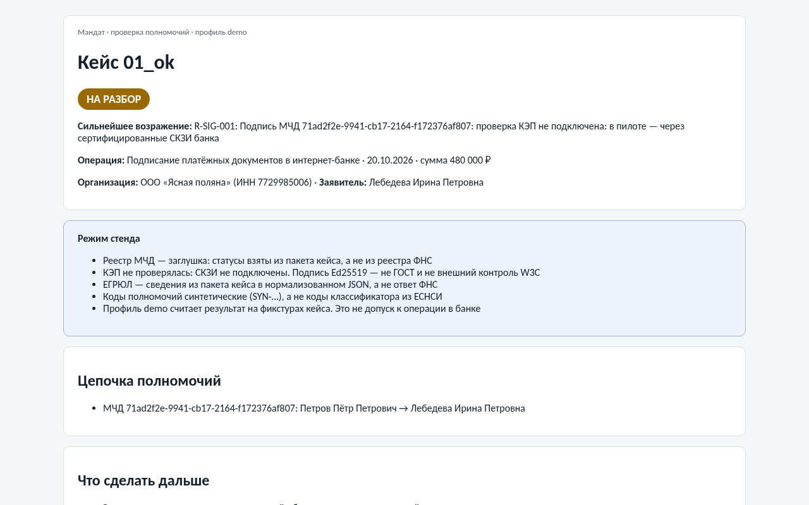
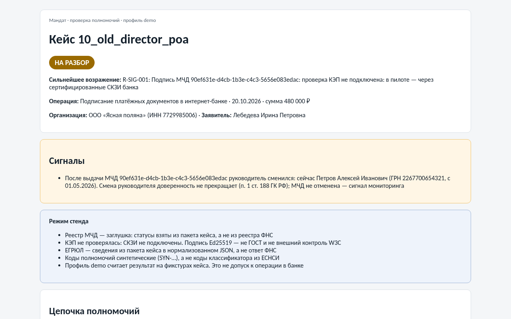
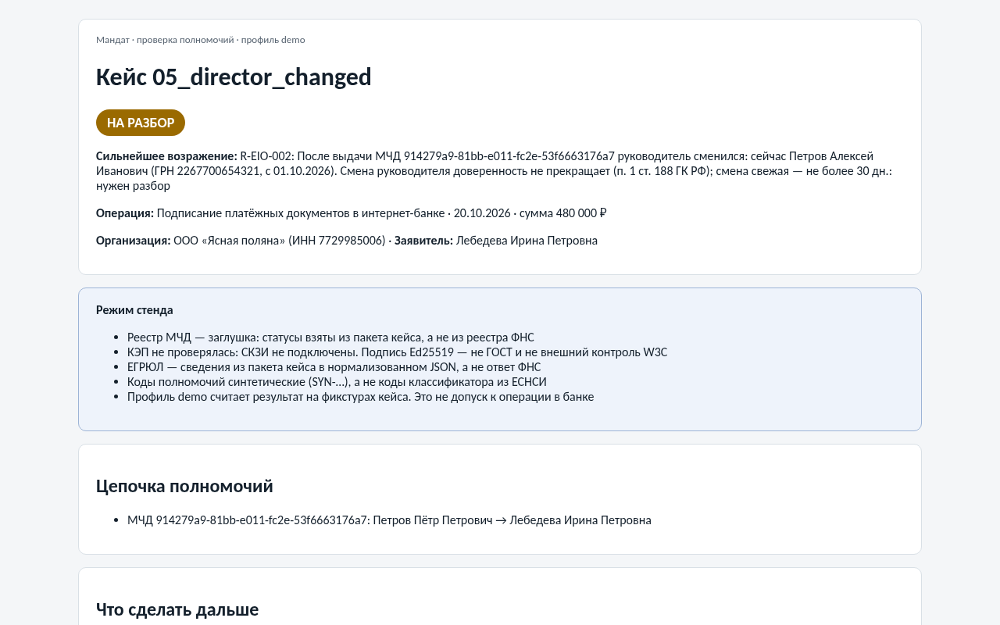
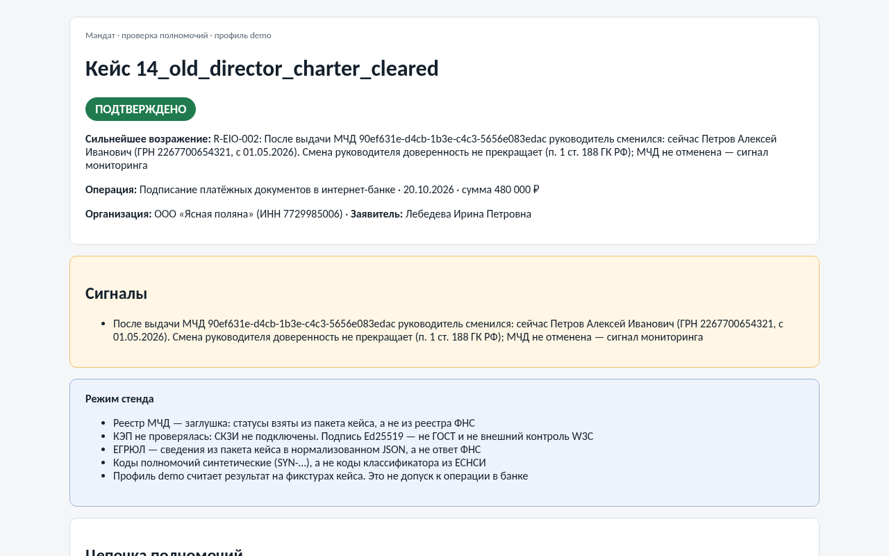
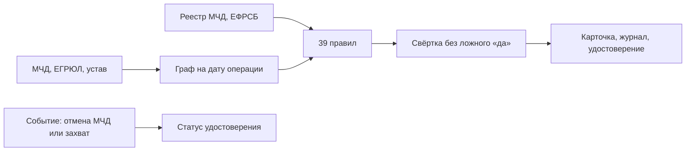

<p align="center">
  
</p>

<p align="center">
  <a href="https://github.com/KonkovDV/Mandat/raw/main/Mandat_VTB.pptx"></a>
  <a href="https://github.com/KonkovDV/Mandat/blob/main/Mandat_VTB.pdf"></a>
</p>

<p align="center">
  <a href="https://github.com/KonkovDV/Mandat/actions/workflows/ci.yml"></a>
  
  <a href="LICENSE"></a>
  <a href="docker-compose.yml"></a>
  
</p>

# Мандат

**Проверка полномочий представителя бизнес-клиента для банка.** Один вопрос: *может ли этот человек провести эту операцию от имени этой компании в этот день?*

Ответов четыре: **ПОДТВЕРЖДЕНО**, **ОПРОВЕРГНУТО**, **НА РАЗБОР** и **НЕДОСТАТОЧНО ДАННЫХ**. К каждому приложено, на чём он держится: поле МЧД, запись ЕГРЮЛ с ГРН, фраза из устава, статья закона. Если данных не хватает, «Мандат» не говорит «да». Он пишет, какого документа нет и какое подразделение ведёт кейс.

Проект сделан для трека ВТБ «Финтех без границ» Академии Финтеха 2026. Это вертикальный срез на вымышленных данных. Что считается по-настоящему, а что пока заглушка, написано ниже. То же самое видно на плашке «Режим стенда» в каждом отчёте.

> **Жюри:** [сценарий показа](docs/DEMO.md) · [реестр утверждений](CLAIMS_REGISTRY.md) · [границы](LIMITS.md) · [конкуренты](docs/COMPETITORS.md) · [аудит, октябрь 2026](docs/AUDIT_2026-10.md) · [карта документов](docs/README.md)

## В двух словах

| | |
|---|---|
| **Что делает** | Строит цепочку «руководитель по ЕГРЮЛ → МЧД → передоверие → представитель» на дату операции, прогоняет её через 39 правил и сводит их в один вердикт с доказательствами |
| **Что уже есть** | 14 демо-кейсов, HTML-карточка, журнал с доказательством включения записи, удостоверение со статусами отзыва и приостановки, мониторинг отмены МЧД и признаков захвата, проверка банкротства по данным кейса, HTTP API с ролями. Всё запускается одной командой |
| **Что измерено** | На синтетическом корпусе правила ловят заложенный дефект, ложных «подтверждено» нет. Это проверка логики, а не точность на документах банка (C-03…C-06 в [реестре](CLAIMS_REGISTRY.md)) |
| **Чего нет** | Живого реестра ФНС и ЕФРСБ, проверки КЭП по ГОСТ, правил, утверждённых юристом банка, кодов классификатора из ЕСНСИ. Права в интернет-банке система не выдаёт: на пилоте она только рекомендует роль |
| **Как запустить** | Windows: `.\run-demo.ps1`, потом открыть `var\demo\01_ok.html`, `10_old_director_poa.html` и `05_director_changed.html` |

## Как посмотреть без установки

Три карточки из `mandat demo` лежат в репозитории как статичные страницы. Картинка ведёт на саму карточку.

| Без опровержений, но устав не закрыт | Давняя смена директора: только сигнал | Свежая смена директора: на разбор | Тот же кейс 10 с отметкой об уставе: подтверждено |
|---|---|---|---|
| [](docs/demo/01_ok.html) | [](docs/demo/10_old_director_poa.html) | [](docs/demo/05_director_changed.html) | [](docs/demo/14_old_director_charter_cleared.html) |

Отметка «по уставу применимых ограничений нет» в кейсе 14 синтетическая: устав никто не проверял, она нужна, чтобы показать единственный путь к «подтверждено». В банке её ставит юрист, и она попадает в журнал.

Обновить: `mandat demo`, затем `python scripts/export_demo_cards.py`.

Запись показа — ссылку добавит команда перед питчем.

## Зачем это банку

Сегодня операционист сам сводит МЧД, выписку ЕГРЮЛ и устав. Если что-то смущает, клиента зовут в офис. Ошибиться можно в обе стороны, и цена разная: лишний отказ злит клиента, а лишнее «да» даёт право подписи человеку, чьи полномочия уже закончились.

С 1 сентября 2024 года представитель юрлица подписывает документы своей квалифицированной подписью и машиночитаемой доверенностью. С 1 февраля 2026 года действуют новые требования к реквизитам МЧД. Проверять нужно не «файл приложен», а всю цепочку на дату операции:

- кто выдал доверенность и был ли он тогда руководителем;
- можно ли было передоверить и не шире ли объём;
- не отменена ли основная доверенность и не истёк ли срок;
- не банкрот ли доверитель;
- покрывает ли полномочие именно эту операцию.

Операторы ЭДО выпускают и хранят МЧД, сервисы проверки контрагентов знают, кто руководитель сейчас. Продукта, который сводит оба слоя с уставом и нормой в объяснимый вердикт на дату и не говорит «да» при пустых данных, в открытых источниках мы не нашли. Разбор в [конкурентах](docs/COMPETITORS.md).

## Четыре ответа

| Вердикт | Когда | Что видит сотрудник |
|---|---|---|
| ПОДТВЕРЖДЕНО | Все обязательные группы проверок закрыты, опровержений нет | Рекомендованную роль (теневой режим) и сильнейшее возражение: что в этом прогоне не проверялось |
| ОПРОВЕРГНУТО | Хотя бы одно правило опровергает полномочие | Норму, поле документа и следующий шаг |
| НА РАЗБОР | Есть спорное: свежая смена руководителя, текстовое полномочие, порог устава, совместная подпись, наблюдение в банкротстве | Маршрут и срок. Решает человек |
| НЕДОСТАТОЧНО ДАННЫХ | Обязательная проверка не выполнена или реестр недоступен | Какого документа не хватает. Это не то же самое, что «доверенность действует» |

Решают правила, а языковая модель только советует. Без дословной цитаты из устава её факт не засчитывается, и вердикт она не меняет. Пояснение, которое говорит «подтверждено» и при этом цитирует опровержение, выбрасывается. Автоматический вердикт можно оспорить: кейс уходит человеку, основание обязательно. Это в логике Кодекса этики в сфере ИИ на финансовом рынке (Банк России, 2025); о присоединении ВТБ 21.08.2026 сообщил CNews.

## Как это устроено



| Шаг | Что происходит | Где в коде |
|---|---|---|
| Приём | XML проходит защиту от бомб и внешних сущностей. Битый документ даёт «недостаточно данных», а не падение | `intake/` |
| Граф | Путь от представителя к руководителю, выдавшему корневую МЧД. Цикл в ссылках обрывается | `domain/graph.py` |
| Правила | Норма, эффекты и текст следующего шага лежат в JSON. Правило без теста не проходит сборку | `data/rules.json`, [каталог правил](docs/RULES.md) |
| Свёртка | Опровержение сильнее нехватки данных, нехватка сильнее разбора, разбор сильнее подтверждения. Молчание обязательной группы успехом не считается | `domain/verdict.py` |
| Вторая свёртка | Тот же ответ считает независимый код. Если они разошлись, падает тест | `domain/verdict_oracle.py` |
| Доказательства | Находка без ссылки на источник не публикуется. Одинаковый вход даёт одинаковый хеш отчёта | `domain/model.py` |
| После выдачи | Отмена основной МЧД переводит удостоверения цепочки в «отозвано», признаки захвата приостанавливают удостоверения организации. Права в интернет-банке при этом не трогаются | `services/monitoring.py` |

На какие нормы опирается срез: смена руководителя доверенность не прекращает (п. 1 ст. 188 ГК РФ), поэтому давняя смена только сигнал, а свежая повод для разбора. Отмена основной МЧД обрывает передоверие (п. 3 ст. 188). Банкротство с утратой права выдавать доверенности её прекращает (подп. 7 п. 1 ст. 188): это внешнее управление и конкурсное производство у организации, а наблюдение и процедуры гражданина отправляют на разбор. Без срока МЧД действует год (ст. 186). Реквизиты сверяются по приказу Минцифры № 1001. Подробности и оговорки в [нормативной базе](docs/REGULATORY.md).

## Словарик экрана

| Слово | Что значит |
|---|---|
| Режим стенда | Плашка в каждом отчёте: реестр, ЕГРЮЛ, ЕФРСБ и подпись в этом прогоне взяты не из систем банка |
| Теневой режим | Роль рекомендована, но в интернет-банк не записана |
| Сильнейшее возражение | Почему итог пока нельзя считать окончательным. На демо-подтверждении это снятая проверка подписи |
| `draft` | У правила есть норма, но юрист банка его ещё не утвердил |
| `demo` и `strict` | В `demo` проверка подписи честно снята. В `strict` без подписи и утверждённых правил автоматического «подтверждено» нет |

## Показ

Полный сценарий с фразами, командами для Windows и ответами на частые вопросы лежит в [docs/DEMO.md](docs/DEMO.md). Коротко:

1. `var/demo/01_ok.html`. Опровержений нет, но устав шаблонами не закрыт, поэтому «на разбор». Плашка стенда на месте.
2. `var/demo/10_old_director_poa.html`. Директор сменился давно, МЧД от этого не прекратилась, это только сигнал.
3. `var/demo/05_director_changed.html`. Смена свежая, кейс уходит на разбор.
4. `var/demo/13_bankruptcy.html`. Доверитель в конкурсном производстве, доверенность прекратилась.
5. Отмена основной МЧД отзывает удостоверение передоверия, признаки захвата приостанавливают удостоверения организации.
6. `mandat journal-proof` доказывает, что запись есть в журнале, и не раскрывает остальные.

Каталог `var/` в git не хранится, его собирает `mandat demo`.

## Цифры, которые можно называть

Каждая строка воспроизводится командой из [реестра](CLAIMS_REGISTRY.md). Правый столбец говорить нельзя: там цифра начинает врать.

| № | Можно сказать | Нельзя говорить |
|---|---|---|
| C-01 | 39 правил, у каждого норма, следующий шаг и тест | что юрист банка их утвердил: все в статусе `draft` |
| C-03 | на 294 синтетических кейсах вердикт совпал с ожидаемым в 294 из 294, ложных «подтверждено» 0 | что это точность на потоке банка |
| C-05 | автоматический вердикт на 38,8% корпуса, ошибок среди них нет | что такой будет доля на реальных доверенностях |
| C-06 | передоверие не шире родительской МЧД на всех 384 двухзвенных цепочках, сверено с Cedar | что это доказано для любого XML |
| C-11 | отмена основной МЧД переводит удостоверения цепочки в «отозвано» | что права в интернет-банке отзываются сами |
| C-14 | разбор кейса на машине разработчика занимает единицы миллисекунд | что так будет в контуре банка, пока там не замерили |

## Что работает, а что заглушка

| Часть | Состояние |
|---|---|
| Разбор МЧД формата 003, защита от XML-бомб | работает; пути сверены с XSD EMCHD_1 из открытых копий, обе ветви (доверенность и передоверие), см. [заметки о формате](docs/FORMAT_NOTES.md) |
| Граф: сроки, однократное передоверие, сужение объёма, каскад отмены, утрата полномочий, совместные полномочия | работает |
| 39 правил, профили `demo` и `strict` | работает, статус `draft`. В `strict` снимок из кейса «подтверждено» не даёт |
| Банкротство доверителя и представителя (R-EIO-004) | правило работает на данных из кейса (`bankruptcy` в манифесте). Живой ЕФРСБ не подключён, нет данных значит «не проверено» |
| Отчёт JSON и HTML: плашка стенда, следующий шаг, сильнейшее возражение, рекомендация роли | работает |
| Журнал: хеш-цепочка, файл-свидетель, дерево Меркла | работает. На стенде HMAC по желанию, при `MANDAT_ENV=pilot` или `prod` без ключа журнал не пишется |
| Удостоверение Ed25519 и списки статусов W3C | работает, индексы случайные, список не меньше 131 072 бит. Это не подпись ГОСТ |
| Мониторинг отмены МЧД и признаков захвата | работает на событиях из файла. В антифрод ничего не отправляется, при заданном секрете событие только подписывается |
| HTTP API | один токен на стенде или пользователи с ролями: `case_id` выдаёт сервер, чужие кейсы не видны |
| Вторая свёртка и сверка передоверия на Cedar | работает в тестах |
| Псевдонимизация ИНН, СНИЛС, паспорта, телефона, почты | работает. ФИО не маскируются |
| Ограничения устава | шаблоны типовых фраз. Модель по желанию и без цитаты молчит |
| Реестр МЧД и ЕГРЮЛ | данные из пакета кейса. Нет записи значит «недостаточно данных», а не «действует» |
| Проверка КЭП | порт есть, без СКЗИ банка статус всегда «не проверено» |
| Коды полномочий | синтетические `SYN-…`. Импорт выгрузки ЕСНСИ готов, коды выбирает банк |

## Запуск

Нужен Python 3.11 или новее.

Windows, без установки в систему:

```powershell
.\run-demo.ps1
```

Из установленного пакета:

```powershell
pip install -e ".[dev,api]"
mandat demo
mandat verify examples/cases/10_old_director_poa --html var/10.html
mandat attest-verify var/demo/attestations/01_ok.json --public-key-file var/demo/public_key.txt --status-dir var/demo/status
mandat monitor examples/events/poa_revoked.json --status-dir var/demo/status
mandat monitor examples/events/takeover.json --status-dir var/demo/status
mandat attest-verify var/demo/attestations/01_ok.json --public-key-file var/demo/public_key.txt --status-dir var/demo/status
mandat journal-proof var/demo/journal.jsonl --seq 3
python -m pytest
```

Порядок важен. Первый `attest-verify` идёт до событий и выходит с кодом 0: удостоверение действует. Событие захвата из `takeover.json` приостанавливает удостоверения организации, поэтому второй `attest-verify` печатает «приостановлено» и выходит с кодом 3. Это ожидаемый результат, а не сбой: код 3 значит «подпись верна, но статус не "действует"». Код 4 — подпись верна, но удостоверение не принимается: истёк срок, чужой издатель или назначение, профиль demo в защищённом режиме. Чтобы вернуться к исходному состоянию, снова выполните `mandat demo`.

На Linux и macOS команды те же. Проверка на Cedar ставится отдельно: `pip install -e ".[dev,api,cedar]"`.

### API

Docker поднимает API только на localhost: `docker compose up --build`. Сначала положите в `.env` токен или список пользователей (образец в `.env.example`). Без них compose не стартует, чтобы стенд не оказался открыт с паролем по умолчанию.

Режимов доступа два. Нужен хотя бы один: без обоих `mandat serve` и контейнер из `docker-compose.yml` не стартуют и пишут, что задать.

| Режим | Как включить | Что получается |
|---|---|---|
| Стенд | `MANDAT_API_TOKEN` | один токен с правами администратора, `case_id` задаёт клиент, повтор даёт 409, перезапись через `?replace=true`. Если задан и `MANDAT_API_USERS`, этот токен не действует |
| Пользователи | `MANDAT_API_USERS`: JSON-массив или путь к файлу | у каждого имя, роль и SHA-256 токена. `case_id` выдаёт сервер, клиентский сохраняется как `client_case_id` |

| Роль | Создаёт кейсы и события | Видит кейсы |
|---|---|---|
| `operator` | да | только свои |
| `reviewer` | да | только свои |
| `auditor` | нет | все |
| `admin` | да | все |

Чужой кейс отвечает 404, как несуществующий. Токен и строку для списка выпускает `mandat api-user --name ivanova --role operator`, сам токен показывается один раз.

Окно лимита частоты и отчёты лежат в хранилище `MANDAT_API_STORE`:

| Значение | Когда | Что нужно |
|---|---|---|
| пусто или `memory` | один процесс, стенд | ничего |
| `sqlite:///var/api.db` | несколько воркеров на одной машине: `mandat serve --workers 4` | только стандартная библиотека, файл в режиме WAL |
| `redis://хост:6379/0` | несколько машин за балансировщиком | `pip install "mandat[redis]"` |

С `--workers` больше одного и хранилищем в памяти `mandat serve` не стартует: у каждого воркера был бы свой лимит и свои отчёты.

### Переменные окружения

| Переменная | Зачем | По умолчанию |
|---|---|---|
| `MANDAT_API_TOKEN` | токен режима стенда | пусто |
| `MANDAT_API_USERS` | пользователи и роли | пусто. Если не заданы ни токен, ни пользователи, API отвечает 503 на всё, кроме `/health` |
| `MANDAT_API_DOCS` | `1` включает Swagger на `/docs` | выключено |
| `MANDAT_API_RATE_PER_MIN` | запросов в минуту с одного адреса, `0` снимает ограничение | 120 |
| `MANDAT_API_STORE` | общее хранилище лимита и отчётов: `memory`, `sqlite:///…`, `redis://…` | `memory` |
| `MANDAT_WEBHOOK_SECRET` | секрет подписи событий мониторинга, `whsec_…`; несколько через пробел для смены ключа, первый текущий. Новый печатает `mandat webhook-secret` | подпись не ставится |
| `MANDAT_ENV` | `demo`, `dev`, `test` или `pilot`, `prod` | `demo` |
| `MANDAT_JOURNAL_KEY` | ключ HMAC журнала | на стенде по желанию, в `pilot` и `prod` обязателен |
| `MANDAT_API_JOURNAL` | журнал аудита HTTP API: запись о проверке пишется до сохранения отчёта; журнал не цел или недоступен — 503, отчёт не сохраняется | на стенде не ведётся; в `pilot` и `prod` без него `POST /v1/cases` отвечает 503 |
| `MANDAT_PII_KEY` | ключ псевдонимизации ПДн | пусто |
| `MANDAT_LLM_*` | локальная модель и белый список хостов | модель выключена |

### Перед сдачей

`make check` на Linux. На Windows по шагам: `python -m ruff check src tests scripts tools`, `python -m ruff format --check src tests scripts tools`, `python -m mypy`, `python -m pytest`, `python scripts/lint_claims.py`. Числа для слайдов пересобирает `python scripts/build_evidence.py`.

## Куда дальше

| Зачем пришли | Куда смотреть |
|---|---|
| Пять минут до питча | [сценарий показа](docs/DEMO.md), [границы](LIMITS.md) |
| Откуда эта цифра | [реестр утверждений](CLAIMS_REGISTRY.md) |
| Как устроен продукт целиком | [каркас MVP](docs/MVP.md), [архитектура](docs/ARCHITECTURE.md) |
| Норма, правило, тест | [правила](docs/RULES.md), [нормы](docs/REGULATORY.md) |
| Почему не другой движок | [мировой уровень](docs/SOTA.md), [конкуренты](docs/COMPETITORS.md) |
| ИБ и данные | [безопасность](SECURITY.md), [модель угроз](docs/THREAT_MODEL.md), [защита данных](docs/DATA_PROTECTION.md), [риски ИИ](docs/AI_RISKS.md) |
| Пилот в банке | [пилот](docs/PILOT.md), [дорожная карта](docs/ROADMAP.md) |
| Что взято из других репозиториев автора | [перенос](docs/PORTING.md) |
| Все документы по ролям | [карта](docs/README.md) |

## Лицензия

MIT, © 2026 Коньков Дмитрий. Организации, ИНН и люди в демо вымышлены.
