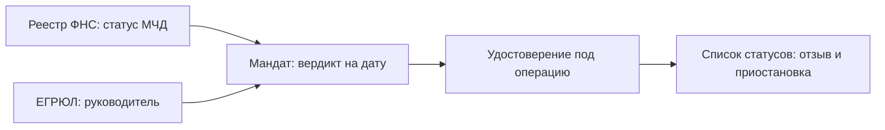

# Аудит, октябрь 2026

> История: срез версии 0.2.3. Что исправлено после него и что остаётся открытым — [docs/audit/AUDIT.md](audit/AUDIT.md) и [ступени готовности](audit/READINESS_GATES.md).

Срез 13.10.2026, версия 0.2.3. Смотрели репозиторий глазами шести людей: инженера на разборе, атакующего, юриста, банкира, специалиста по ИБ и члена жюри. Ниже то, что нашли, что исправили сразу и что оставили на пилот.

## Итог в одной таблице

| Проверка | До | После |
|---|---|---|
| `pytest` | 99 тестов, зелёные | 108 тестов, зелёные |
| `ruff check` | чисто | чисто |
| `ruff format --check` | 1 файл не отформатирован | чисто, проверка добавлена в CI и `make lint` |
| `mypy` (в проекте не был настроен) | 6 замечаний о типах | чисто, проверка в CI и `make lint` |
| `pip-audit` | уязвимостей в зависимостях проекта нет; старый `pip` 25.0.1 в venv | то же; с 13.10 `pip-audit` идёт в CI после обновления `pip` |
| `scripts/lint_claims.py` | запрещённых формулировок нет | то же |
| `mandat demo`, `eval`, `journal-verify` | проходят, журнал 12 записей, целостность OK | то же |

## Что исправлено

| Важность | Где | Было | Стало |
|---|---|---|---|
| Высокая | `docker-compose.yml` | Без `.env` API поднимался с токеном `change-me` | Compose и `mandat serve` не стартуют, если не задан ни `MANDAT_API_TOKEN`, ни `MANDAT_API_USERS` |
| Средняя | `api/app.py` | Отчёты копились в памяти без предела: поток `POST /v1/cases` съедал память ([OWASP API4:2023](https://owasp.org/API-Security/editions/2023/en/0x11-t10/)) | Не больше `MAX_REPORTS = 1000`, старые вытесняются; тест `test_api_keeps_a_bounded_number_of_reports` |
| Низкая | `audit/status_list.py` | Файл не проходил `ruff format` | Отформатирован; формат проверяется в CI |
| Низкая | `.gitignore` | Архивы вроде `Mandat.zip` могли случайно попасть в коммит | `*.zip` в игноре |
| Низкая | `README.md` | Текст про токен `change-me` | Описано, откуда брать токен |

## Взгляд атакующего

Что пробовали сломать и чем это кончилось.

| Атака | Результат | Где закрыто |
|---|---|---|
| Запрос без токена или с чужой схемой | 503 без настроенного токена, иначе 401; сравнение через `hmac.compare_digest` | `api/app.py`, тесты `test_api_*` |
| Огромное тело или кривой `Content-Length` | 413 и 400 до разбора JSON | middleware `limit_body` |
| `../` в пути документа кейса | Отказ: путь должен остаться внутри каталога кейса | `intake/case_loader.py` |
| XXE и «миллиард смеха» в XML МЧД | `defusedxml` | `intake/xml_safety.py` |
| Передоверие без права, повторное передоверие, срок длиннее основной МЧД, шире объём, другой доверитель | ОПРОВЕРГНУТО с указанием поля | `R-SUB-*` в `rules/checks.py` |
| Отмена основной МЧД после выдачи передоверия | Каскадно гаснет и передоверие | `sub_cascade`, кейс `11_parent_revoked` |
| Правка или удаление записи журнала | Ломается хеш-цепочка или файл-свидетель `.head` | `audit/journal.py` |
| HTML-инъекция в отчёт | Экранирование и CSP `default-src 'none'` | `report/html.py`, `api/app.py` |

Что нашли и как закрыли во второй волне:

| Находка | Решение |
|---|---|
| Журнал без ключа проверяется только по хешам: злоумышленник с правом записи пересчитает цепочку и свидетеля | При `MANDAT_ENV=pilot` или `prod` журнал без `MANDAT_JOURNAL_KEY` не пишется. `journal-verify --merkle-anchor` сверяет корень Меркла, сохранённый вне сервера |
| Повторный `POST` с тем же `case_id` молча перезаписывал чужой отчёт ([API1:2023](https://owasp.org/API-Security/editions/2023/en/0x11-t10/)) | 409, перезапись только явно, через `replace=true` |
| `/docs` и `/openapi.json` открыты без токена ([API9:2023](https://owasp.org/API-Security/editions/2023/en/0x11-t10/)) | Выключены, пока не задан `MANDAT_API_DOCS=1` |
| Нет ограничения частоты запросов | 120 запросов в минуту с адреса, настраивается `MANDAT_API_RATE_PER_MIN` |

Последнее открытое место, общий доступ к кейсам, закрыто в третьей волне: пользователи с ролями, владельцы кейсов и `case_id`, который выдаёт сервер.

## Взгляд юриста

Опорные нормы, которые сверяли с правилами:

- С 1 сентября 2024 года представитель юрлица подписывает квалифицированной подписью физлица вместе с МЧД (ст. 17.2, 17.3 63-ФЗ). Источник: [ФНС, Московская область](https://www.nalog.gov.ru/rn50/news/activities_fts/15636183/). Отсрочку на год дал 457-ФЗ: [КонсультантПлюс](https://vkons.ru/news/c0/12294-perekhod-na-mashinochitaemye-doverennosti-poyavilis-novye-razyasneniya).
- Передоверие возможно, если оно разрешено доверенностью; срок передоверия не длиннее основной доверенности; последующее передоверие запрещено, если первоначальная доверенность не говорит иного (п. 1, 4, 7 ст. 187 ГК РФ): [КонсультантПлюс, ст. 187](https://www.consultant.ru/document/cons_doc_LAW_5142/33554de4cc03f8450fefcd3a75ba2e29ac4915c9/). Все три пункта есть в правилах `R-SUB-*`.
- С прекращением доверенности теряет силу передоверие (п. 3 ст. 188 ГК РФ): [КонсультантПлюс, ст. 188](https://www.consultant.ru/document/cons_doc_LAW_5142/c511d2a3c68c7a42497babc32771904550debd21/). Это `sub_cascade`.
- Добросовестный контрагент, который не знал и не должен был знать об отмене, защищён (п. 2 ст. 189 ГК РФ): [Гарант, ст. 189](https://base.garant.ru/10164072/89f61847aabb3fde12aaa2897281285b/). Для банка отсюда практический вывод: момент проверки реестра надо фиксировать в журнале, иначе «не знал» не доказать.

Чего правила пока не знают: банкротство и ликвидация доверителя как основания прекращения (подп. 4 и 7 п. 1 ст. 188) проверяются только через статус организации в ЕГРЮЛ, а не через ЕФРСБ. Юридического заключения банка по набору правил нет, это записано в [LIMITS.md](../LIMITS.md).

По 152-ФЗ: ПДн псевдонимизируются ключом `MANDAT_PII_KEY`, модель получает только цитаты. Оценку вреда и модель угроз ПДн для пилота готовит банк.

## Взгляд банкира

Боль простая: операционист вручную сводит МЧД, выписку ЕГРЮЛ и устав, а при сомнении клиента зовут в офис. Цена ошибки несимметрична: лишний отказ раздражает клиента, а лишнее «да» даёт право человеку, у которого полномочия уже кончились. Поэтому главный показатель «Мандата» не точность, а отсутствие ложного ПОДТВЕРЖДЕНО, и именно его меряет синтетический корпус. Для пилота нужен теневой режим на реальных кейсах и сверка с решениями сотрудников, это описано в [PILOT.md](PILOT.md).

## Взгляд ИБ

- Секреты только из окружения, `.env` в игноре, образец без значений.
- Контейнер: непривилегированный пользователь, `read_only`, `no-new-privileges`, порт только на `127.0.0.1`.
- Клиент локальной модели ходит только на хосты из белого списка (защита от SSRF, [API7:2023](https://owasp.org/API-Security/editions/2023/en/0x11-t10/)).
- Для пилота в банке понадобятся сверка с ГОСТ Р 57580 и требованиями Банка России к операционной надёжности, подписи по ГОСТ вместо Ed25519 и интеграция журнала с SIEM. В этом аудите тексты этих документов не разбирались, поэтому конкретных пунктов здесь нет.

## Взгляд жюри

Сильное: честные границы (плашка «Режим стенда», реестр утверждений, линтер запрещённых формулировок), запуск одной командой, доказательства у каждого вердикта. Что усилить: на питче показать один кейс атаки (передоверие длиннее основной МЧД) и один кейс отмены с каскадом, это быстрее всего объясняет, зачем нужна цепочка, а не «файл приложен».

## Как это делают в мире

| Подход | Что берём для «Мандата» |
|---|---|
| [W3C Bitstring Status List v1.0](https://www.w3.org/TR/vc-bitstring-status-list/), рекомендация W3C от 15.05.2025 | Отзыв и приостановка битом в сжатом списке. Спецификация требует минимум 131 072 записи для групповой приватности и советует случайные индексы. В `audit/status_list.py` размер 131 072 бита, индексы случайные |
| [GLEIF vLEI](https://www.gleif.org/en/organizational-identity/become-a-vlei-issuer-qvi/vlei-ecosystem-governance-framework), EGF v4.0 от 25.03.2026 | Удостоверение официальной роли (OOR) выдаётся после авторизации от представителя юрлица: та же идея «роль из первичного источника», что и сверка руководителя по ЕГРЮЛ |
| [EUDI Wallet ARF 2.8.0](https://eu-digital-identity-wallet.github.io/eudi-doc-architecture-and-reference-framework/2.8.0/architecture-and-reference-framework-main/) | Представительство оформляется отдельным типом аттестации с явным перечнем операций; такие аттестации либо короткоживущие, либо отзываемые ([обсуждение, тема I](https://eudi.dev/2.2.0/discussion-topics/i-natural-person-representing-another-natural-person/)). Совпадает с тем, как «Мандат» выдаёт удостоверение под операцию |
| Распределённый реестр МЧД ФНС, [m4d.nalog.gov.ru](https://www.nalog.gov.ru/html/sites/www.rn65.nalog.ru/%D1%81%D0%B5%D0%BC%D0%B8%D0%BD%D0%B0%D1%80%D1%8B/%D0%92%D1%8B%D0%B4%D0%B0%D1%87%D0%B0%20%D0%9C%D0%A7%D0%94%20%D0%BF%D0%B0%D0%BC%D1%8F%D1%82%D0%BA%D0%B0_%D0%A4%D0%9D%D0%A1%20public_3-HM.pdf) | Проверка по GUID доверенности. В стенде это заглушка порта `registry`, на пилоте нужен живой адаптер |

## Что осталось

| Что | Статус |
|---|---|
| Шесть замечаний `mypy`, `mypy` в CI | закрыто, `mypy` в CI и `make lint` |
| Ключ журнала вне стенда, внешний якорь | закрыто, см. [SECURITY.md](../SECURITY.md) |
| Защита от перезаписи кейса, Swagger, частота запросов | закрыто |
| ЕФРСБ | закрыто правилом R-EIO-004 на данных кейса, демо-кейс `13_bankruptcy`; живой адаптер на пилот |
| Пользователи и роли в API | закрыто: `MANDAT_API_USERS`, владельцы кейсов, `case_id` от сервера; OIDC банка на пилот |
| Порядок выдачи индексов в списке статусов | закрыто: индексы и раньше брались из `secrets`, добавлены проверки размера и границ |
| `Mandat_VTB.pptx` и `Mandat_VTB.pdf` в истории git | файлы оставлены на месте, чтобы не ломать ссылки из README. Новые версии лучше выкладывать в релизы GitHub, а старые вычищать из истории только по решению автора: это переписывает историю |

## Повторный аудит 13.10.2026

Прошёл заново весь код и документы, включая свои же правки последних дней. Каждую атаку проверял тестом, а не на глаз. Номера статей и цифры сверял с кодом, `evidence.json` и открытыми источниками.

### Находки

| Важность | Где | Что нашлось | Что сделано |
|---|---|---|---|
| Высокая | `domain/identifiers.py` | `str.isdigit()` и `\d` пропускают арабские и полноширинные цифры, а `int()` их переводит. ИНН `٧٧٢٩٩٨٥٠٠٦` проходил контрольное число, но по строке не совпадал ни с одной записью: банкротство, реестр и сверка сторон его бы не нашли | только цифры ASCII, `fullmatch` без хвостового перевода строки. Тесты на случайных реквизитах |
| Высокая | `EVALUATION.md`, `MVP.md`, `CLAIMS_REGISTRY.md`, README | Цифры корпуса устарели ещё в 0.2.3: 204 кейса и покрытие 55,9%, а на деле все «зелёные» сценарии уходили на разбор из-за устава. В корпусе не было ни одного ожидаемого «подтверждено», так что метрика ложных подтверждений путь к «да» вообще не проверяла | вид `ok_charter_cleared` с отметкой юриста по уставу. Сейчас 210 кейсов, 210 из 210, ложных «подтверждено» 0 из 204, покрытие 42,9%, верхняя граница риска 4,1%. Тексты переписаны |
| Средняя | `api/principals.py` | Если заданы и `MANDAT_API_USERS`, и `MANDAT_API_TOKEN`, общий токен молча давал администратора рядом с ролями | рядом со списком пользователей общий токен не действует, тест |
| Средняя | `intake/case_loader.py` | ИНН числом в JSON (`7729985006` без кавычек) ронял API с 500 | реквизиты принимаются только строкой, ответ 422, тест |
| Средняя | `scripts/build_evidence.py` | `evidence.json` собирал 12 демо-кейсов из 13: `13_bankruptcy` не попадал | берутся все кейсы, файл пересобран |
| Низкая | `api/app.py` | таблица ограничения частоты росла без предела при запросах с множества адресов | при 10 000 адресов старые окна выбрасываются |
| Низкая | `cli.py` | `mandat eval` возвращал 0 при расхождении вердиктов, если не было ложного «подтверждено» | код 1 при любом расхождении, CI теперь ловит регрессию |
| Низкая | CI | сборку образа проверяли, запуск нет | шаг: контейнер без токена и пользователей выходит с кодом 2 |
| Низкая | `docs/RULES.md` | «все 33 правил» | генератор поправлен |

### Что проверил и оставил как есть

- Сравнение токенов: хеши SHA-256 через `hmac.compare_digest`, время не зависит от совпадения.
- Перебор кейсов: чужой и несуществующий кейс одинаково дают 404, запись от `auditor` даёт 403 до поиска кейса, поэтому по кодам ответа существование кейса не узнать. В режиме пользователей `case_id` случайный, 64 бита.
- `X-Forwarded-For` для лимита не читается, адрес берётся из соединения. Тест.
- Тело без `Content-Length` (chunked) больше 8 МБ отвергается с 413, JSON глубокой вложенности даёт 400, не 500. Тест на chunked.
- Путь в `MANDAT_API_USERS` задаёт администратор сервера, а не клиент API, поэтому обход каталога здесь не угроза.
- Срок МЧД без даты: год включительно (п. 1 ст. 186 и [п. 1 ст. 192 ГК РФ](https://www.consultant.ru/document/cons_doc_LAW_5142/f2c3ac8b0451102f5a894bb9445903ef0373bba1/)), с 29.02 до 28.02. Тесты на границы и високосный год. Сверил с [консультацией Гаранта](https://www.garant.ru/consult/practice/1819950/): срок начинает течь на следующий день после даты совершения (ст. 191 ГК РФ), а годовой срок, начавшийся 26.12.2012, оканчивается 25.12.2013. Значит, МЧД от 10.03.2025 последний день действует 10.03.2026, как и считает код. Перенос 29.02 на 28.02 сделан по аналогии с п. 3 ст. 192, прямой нормы для годов нет: это вопрос юристу банка.
- Даты приказа Минцифры № 1001 (подписан 05.11.2025, в силе с 01.02.2026) сверены по [«Российской газете»](https://rg.ru/documents/2026/01/22/mincifry-prikaz1001-site-dok.html). 315-ФЗ от 04.08.2026 с 01.09.2027 есть на [kremlin.ru](http://kremlin.ru/acts/bank/53590). Разметка банкротства сверена в предыдущем проходе, таблица в [REGULATORY.md](REGULATORY.md#банкротство).

### Что осталось

Все четыре пункта закрыты 13.10.2026, см. следующий раздел.

## Закрытие оставшихся пунктов — 13.10.2026

**Цепочка поставки.** Сверено с [руководством GitHub по защите Actions](https://docs.github.com/en/actions/security-for-github-actions/security-guides/security-hardening-for-github-actions), [scorecard-action](https://github.com/ossf/scorecard-action), [actions/attest](https://github.com/actions/attest) и [pip-audit](https://github.com/pypa/pip-audit).

- Все действия закреплены полным SHA коммита, версия в комментарии рядом. Dependabot (`.github/dependabot.yml`) раз в неделю предлагает обновления для actions, pip и базового образа Docker. Образ `python:3.12-slim` закреплён по дайджесту.
- `permissions: {}` на уровне workflow, каждой задаче выдано только нужное, `checkout` без сохранения токена (`persist-credentials: false`).
- `pip-audit --skip-editable` в каждой сборке матрицы.
- На push в `main` собираются wheel и sdist, SBOM CycloneDX 1.6 снимается с чистого окружения, где стоит только wheel, затем `actions/attest` подписывает происхождение сборки (SLSA provenance) и SBOM. Локально сборка и SBOM проверены: 19 компонентов.
- Scorecard раз в неделю и на push, результат в Code scanning.
- `harden-runner` не добавлен сознательно: в режиме audit он отправляет телеметрию сборки внешнему сервису, а раннеры GitHub и так одноразовые. Вернуться к нему стоит, если сборка переедет на свои раннеры.
- В `pyproject.toml` лицензия записана выражением SPDX, сборка больше не предупреждает об устаревшем формате.

**Вебхуки** по [Standard Webhooks 1.0](https://github.com/standard-webhooks/standard-webhooks/blob/main/spec/standard-webhooks.md): секрет `whsec_` + base64 от 24 до 64 байт (`mandat webhook-secret`), несколько секретов через пробел для смены ключа, подпись каждым, проверка принимает любую. Окно ±5 минут, `webhook-id` можно запоминать в хранилище, повтор отвергается. Старый секрет без префикса работает как раньше. Тест на эталонный вектор из тестов библиотеки Standard Webhooks.

**Хранилище** (`src/mandat/api/storage.py`): память по умолчанию, `sqlite:///путь` или `redis://…` через `MANDAT_API_STORE`. Лимит и вытеснение в SQLite делаются в `BEGIN IMMEDIATE`, в Redis одним Lua-скриптом, поэтому несколько воркеров видят один счётчик. Тест с несколькими процессами на одном файле SQLite. `mandat serve --workers N` с памятью не стартует. Пакет `redis` ставится отдельно: `pip install "mandat[redis]"`.

**Юрист.** Вопросы собраны в [LEGAL_REVIEW.md](LEGAL_REVIEW.md). При сверке ст. 187 ГК РФ нашлись неточные номера пунктов в `rules.json` (R-SUB-001, R-SUB-003, R-SUB-007), исправлены. Новая находка: нотариальная форма передоверия от физлица (п. 3 ст. 187) в коде не проверяется, вопрос записан. Регистрация приказа № 1001 сверена на publication.pravo.gov.ru: зарегистрирован в Минюсте 20.01.2026 № 84990.

| Что | Почему не сейчас |
|---|---|
| Нотариальная форма передоверия от физлица | ждём ответа юриста, см. LEGAL_REVIEW, раздел 4 |
| Постоянное хранилище отчётов банка (Postgres) | SQLite и Redis закрывают несколько воркеров, долгий архив — задача пилота |

## Итоговый аудит, 13.10.2026

Проверено на main после df1e911: 322 теста, регрессии аудита 105 из 105, ruff, mypy, lint_claims.

| Приоритет | Находка | Статус |
|---|---|---|
| P0 | Фазз из набора проверки ничего не проверял: ни одна базовая выборка не давала «подтверждено». Когда базе дали отметку об уставе, вышло 90 ложных «подтверждено» и ещё 438 на вариантах формата: пустой parent_number, чужой ОГРН, ИНН заявителя не к тому СНИЛС, регистр номера, незакрытая старая запись руководителя, варианты статуса реестра, нет обязательных полей доверенности | Подтверждено. Это пункт 1 внешнего аудита, его исправляет отдельная ветка. Здесь не исправлялось |
| P1 | Кейс 10 с отметкой об уставе даёт «подтверждено» (пункт 3) | Подтверждено. Добавлен демо-кейс 14, отметка в нём синтетическая (b25f675) |
| P1 | «Сильнейшее возражение» называло снятую проверку R-SIG-001 (пункт 4) | Подтверждено. Исправлено, добавлен тест (b25f675) |
| P1 | Устаревшие тексты (пункт 5) | Подтверждено. Исправлено в b689c97 |
| P1 | Слайд 5 расходился с демо (пункт 6) | Подтверждено. Вердикты на слайде теперь берутся из evidence.json (df1e911) |
| P2 | M-09 (≈1,8 млн) | Подтверждено только пересказом СМИ. Сайт vtb.ru не открылся из-за ошибки доверия TLS, поэтому в тексте стоит пометка «не проверено по первичному источнику» |
| P2 | Размер доказательства Merkle | Размер берётся из доверенной головы дерева. Так задумано (RFC 9162), это не дефект |
| — | Собственные ошибки: в bench было жёстко прописано «33 правила»; базовая выборка фазза ничего не проверяла; CI упал на CVE в setuptools; неверная дата у M-09 | Исправлено в f6b1dc4, 9e76f29 и 7e4eb90. Фазз отнесён к пункту 1 |

## Вторая глубокая волна, 13.10.2026

Срез main 4a3ffbf, CI зелёный. Смотрели движок вердиктов и 39 правил на граничных датах, пути к ложному «подтверждено», API, разбор XML, журнал и дерево Меркла, гонки, ключи, зависимости, Docker, CI и расхождения документов с кодом. Каждое исправление идёт с тестом в `tests/test_audit_deep2.py`; без исправления тест падает (проверено откатом каждой правки).

| Важность | Находка | Как воспроизвести | Решение |
|---|---|---|---|
| Средняя | МЧД с неизвестной кодировкой в прологе (`encoding="TF-8"`) роняла разбор: `LookupError`, в API ответ 500, в CLI трассировка | `POST /v1/cases` с такой МЧД | Документ отклоняется как непринятый, вердикт «недостаточно данных» (`intake/xml_safety.py`) |
| Средняя | В `pilot` и `prod` без `MANDAT_PII_KEY` псевдонимизация молча брала ключ разработки из репозитория: токен ИНН восстанавливается перебором. Обещанного в коде предупреждения не было | `MANDAT_ENV=pilot`, без ключа, `pseudonymize("ИНН 7707083893")` | Вне demo, dev и test без ключа — отказ `PiiKeyMissing` (`privacy/pii.py`) |
| Низкая | Два пользователя с одним `token_sha256` принимались, запрос доставался последнему в списке, журнал писал не то имя | `MANDAT_API_USERS` с двумя именами и одним хешем | Список с повтором токена не загружается (`api/principals.py`) |
| Низкая | Ключ подписи и ключ HMAC читались с любыми правами файла | `chmod 644 var/demo/keys/*`, затем `mandat demo` | Ключ с правами шире 0600 не читается, сообщение просит `chmod 600` (`audit/attestation.py`) |
| Низкая | `attest-verify` выходил с кодом 0 для удостоверения опровергнутого кейса и не печатал вердикт; без `--status-dir` статус молча не проверялся | `mandat attest-verify var/demo/attestations/07_revoked.json --public-key …` | Вердикт печатается всегда, без `--status-dir` — предупреждение (`cli.py`) |
| Низкая | Время события на краю календаря (`9999-12-31T23:59:59+14:00`, `0001-01-01T00:00:00`) давало `OverflowError` и 500 в `/v1/events` | `POST /v1/events` с таким `at` | Время вне 1900–9998 годов — 422 с понятной причиной (`services/monitoring.py`) |

Что проверили и оставили как есть:

- Ложное «подтверждено». Больше 60 правок подтверждённого синтетического кейса: границы срока (день выдачи — в сроке, день до выдачи и день после окончания — опровержение), границы полномочий руководителя по ЕГРЮЛ и возраста снимка реестра, отмена в день операции и после неё, регистр и пробелы в номере, дубли `СвДов`, `Доверит` и `Пред`, чужие ИНН и СНИЛС, статусы ЕГРЮЛ, кодировки и пространства имён. «Подтверждено» осталось только там, где оно верно по смыслу. Фазз всех полей манифеста и случайные правки XML через API: после исправлений ни одного 500.
- Дерево Меркла сверено с RFC 9162, раздел 2.1.3.2. Журнал: порядок, ссылки, HMAC записей и свидетеля, строгий разбор JSON.
- `pip-audit` по полному списку зависимостей окружения: уязвимостей нет. Docker: образ по дайджесту, пользователь без root, файловая система только для чтения.

Открыто:

| Что | Почему не сейчас |
|---|---|
| Гонка в режиме стенда: два одновременных `POST` с одним `case_id` оба проходят проверку на 409, второй перезаписывает первый | Только режим одного токена администратора; в режиме пользователей `case_id` выдаёт сервер. Нужна атомарная запись «только если нет» во всех трёх хранилищах |
| `ВидДовер=2` без родительской МЧД разбирается как корневая доверенность | Смысл значений `ВидДовер` в XSD не описан (docs/FORMAT_NOTES.md); правило без первичного источника не добавляем, вопрос юристу |
| Зависимости в Docker и CI ставятся без файла блокировки версий | Scorecard отмечает это в Pinned-Dependencies; файл блокировки с хешами — задача сборки для пилота |
| `observed_at` снимка реестра переводится в дату в своём часовом поясе, а не в московском | Сдвиг на сутки только ужесточает проверку возраста снимка; ложного «подтверждено» не даёт |

Проверки после исправлений: `pytest` 594, `ruff check`, `ruff format --check`, `mypy` (55 файлов), `lint_claims`, `check_links`, `mandat eval --per-defect 6` (294 кейса, 0 ложных «подтверждено», расхождений нет), `mandat demo` и `journal-verify` (14 записей, целостность OK). Числа в README обновлены из `evidence.json`, пересобранного `scripts/build_evidence.py`.
