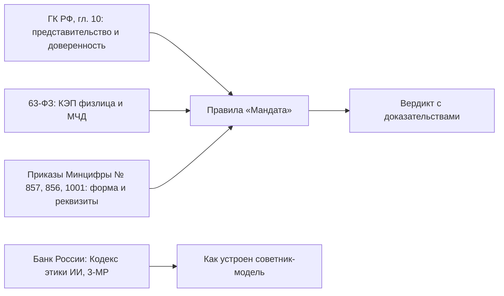

# Нормативная база

Что действует на октябрь 2026 года и как это отражено в «Мандате». Ревизия от 13.10.2026, собрана по открытым источникам.

> Это рабочая сводка команды, а не юридическое заключение. Перед пилотом каждую строку проверяет юрист банка. После этого правила в `data/rules.json` переходят из `draft` в `approved`.

Насколько можно верить строке, показывает столбец «Уверенность»:

| Уровень | Что за ним стоит |
|---|---|
| высокая | первоисточник (publication.pravo.gov.ru, kremlin.ru, cbr.ru, consultant.ru) или несколько независимых профильных источников |
| средняя | профильные источники без первоисточника |
| низкая | единственный источник или источники спорят между собой |

## Карта норм

## Сводная таблица

| Акт | Когда действует | Суть | Что это значит для «Мандата» | Уверенность |
|---|---|---|---|---|
| 63-ФЗ в ред. 476-ФЗ | МЧД обязательна с 01.09.2024 | Представитель юрлица подписывает своей КЭП физлица вместе с МЧД. Сертификаты «сотрудника юрлица» после 31.08.2024 не действуют | На этом стоит весь продукт: представитель = КЭП + МЧД (R-FMT-001, R-SIG-001) | высокая |
| Приказ Минцифры № 857 от 18.08.2021 | действует | Единые требования к формам доверенностей | Обязательные реквизиты (R-FMT-002, R-FMT-003) | высокая |
| Приказ Минцифры № 856 от 18.08.2021 | действует | Основа классификатора полномочий | Откуда брать коды вместо `SYN-…` (R-COV-001, R-COV-002) | высокая |
| Приказ Минцифры № 1001 от 05.11.2025 | зарег. Минюстом 20.01.2026 № 84990, в силе с 01.02.2026 | Паспорт представителя больше не обязателен (нужны ФИО, дата рождения, СНИЛС, ИНН). Появились КПП и СНИЛС руководителя доверителя, сведения о филиалах, наименование полномочия рядом с кодом | Представитель сверяется по СНИЛС или ИНН (R-ID-003), реквизиты новых МЧД (R-FMT-003), наименование доверителя по ЕГРЮЛ (R-ID-004) | реквизиты приказа высокая, содержание изменений средняя |
| 315-ФЗ от 04.08.2026 | принят Госдумой 21.07.2026, одобрен Советом Федерации 24.07.2026, в силе с 01.09.2027 | Единая форма МЧД на Госуслугах становится универсальной. Специальные формы остаются как дополнительные, в том числе формы Банка России для участников финансового рынка и нотариальные. Полномочия задаются по классификатору | Разбор через адаптеры форматов (`intake/formats.py`), слот под форму Банка России (ADR-008) | высокая |
| 304-ФЗ от 31.07.2025 | в силе с 01.03.2026 | Изменения 63-ФЗ (по данным Гаранта) | Содержание не проверено, нужно проверить до второго спринта | низкая |
| ГК РФ, ст. 186, 192 | действует | Если срок не указан, доверенность действует год со дня совершения. Годовой срок истекает в те же месяц и число следующего года ([п. 1 ст. 192](https://www.consultant.ru/document/cons_doc_LAW_5142/f2c3ac8b0451102f5a894bb9445903ef0373bba1/)) | Срок по закону вместо опровержения (R-TERM-001, R-TERM-002). Срок течёт со следующего дня (ст. 191), поэтому в день годовщины МЧД ещё действует. С 29.02 срок идёт до 28.02 по аналогии с п. 3 ст. 192, это должен подтвердить юрист банка | высокая |
| ГК РФ, ст. 187 | действует | Передоверить можно, если это разрешено доверенностью (п. 1). Передоверие от юрлица нотариально удостоверять не нужно (п. 3). Срок передоверия не длиннее основной доверенности (п. 4). Дальнейшее передоверие запрещено, если первоначальная доверенность его не разрешает (п. 7) | R-SUB-001 (право передоверия и однократность), R-SUB-002 (объём), R-SUB-003 (срок) | высокая |
| ГК РФ, ст. 188 | действует | Исчерпывающий перечень оснований прекращения (п. 1): среди них отмена, прекращение юрлица (подп. 4) и банкротство, при котором лицо теряет право выдавать доверенности (подп. 7). С прекращением доверенности теряет силу передоверие (п. 3) | Смена руководителя не основание (R-EIO-002). Ликвидация и банкротство (R-EIO-004). Каскад (R-SUB-006) | высокая |
| ГК РФ, ст. 188.1 | действует | Безотзывная доверенность | Согласованность признаков (R-FMT-004) | норма высокая, значения признаков средняя |
| ГК РФ, ст. 189 | действует | Сделка с добросовестным третьим лицом, которое не знало об отмене, сохраняет силу (п. 2) | Время каждой проверки пишется в журнал (поле `at`): по нему видно, что банк знал на тот момент | высокая |
| Кодекс этики в сфере ИИ на финансовом рынке (Банк России) | июль 2025, рекомендательный | Человек в центре, справедливость, прозрачность, безопасность, управление рисками. Клиент вправе попросить, чтобы решение пересмотрел человек, и должен знать, что применяется ИИ | Модель только советует (ADR-001), апелляция `appeal` в разборе, матрица рисков (`docs/AI_RISKS.md`) | высокая |
| Присоединение ВТБ к Кодексу | 21.08.2026 | Меморандум подписан | Довод для жюри: «Мандат» спроектирован в логике Кодекса | высокая (CNews) |
| Методические рекомендации Банка России № 3-МР от 16.06.2026 | рекомендательные | ИБ при разработке и применении ИИ на финансовом рынке | Матрица рисков ИИ (`docs/AI_RISKS.md`) | средняя: видели заголовок и фрагмент, полного текста не читали |
| Закон «О поддержке развития технологий ИИ в РФ» (законопроект № 1271570-8) | принят Госдумой 08.07.2026, в силе с 01.09.2026, часть норм с 01.03.2027 | Крупные фундаментальные модели, понятия «суверенной» и «национальной» модели, возможность ограничить иностранные модели на чувствительных объектах | Провайдер модели сменный, по умолчанию российская модель с открытыми весами (ADR-005) | средняя: номер и дата подписания в источниках расходятся |
| Приказ ФСТЭК № 117 от 11.04.2025 | в силе с 01.03.2026, заменил приказ № 17 | Защита ГИС и ИС госорганов, отдельный блок про ИИ | Коммерческому банку напрямую не обязателен, используем как чек-лист | даты высокая, применимость к банку низкая |
| 161-ФЗ, антифрод | с 01.01.2026 признаков перевода без согласия 12 вместо 6. Признак «получатель в ГИС "Антифрод"» с 01.03.2026 | Банк проверяет получателя по базе ФинЦЕРТ | Сигнал «смена реквизитов + новый получатель» в мониторинге. В стенде без связи с ФинЦЕРТ | высокая |

## Смена руководителя

ФНС разъясняет: смены руководителя нет в исчерпывающем перечне оснований прекращения доверенности (п. 1 ст. 188 ГК РФ). Выданные раньше МЧД продолжают действовать, а новый руководитель может их отменить. В 2026 году ту же позицию повторяют Диадок, Saby, Клерк и Инфостарт, признаков пересмотра мы не нашли.

Как это сделано (ADR-002, R-EIO-002):

| Ситуация | Вердикт | Демо-кейс |
|---|---|---|
| МЧД прежнего руководителя не отменена, срок не истёк | **подтверждено** с сигналом мониторинга | `10_old_director_poa` |
| Смена свежая (`fresh_change_days`, по умолчанию 30 дней) или операция высокого риска | **на разбор**: так начинается захват компании через подставного руководителя | `05_director_changed` |
| Основная доверенность отменена | **опровергнуто**: передоверие теряет силу (п. 3 ст. 188 ГК РФ) | `11_parent_revoked` |

## Банкротство

> **Требует подтверждения юристом банка.** Таблица ниже собрана по тексту закона и опубликованной практике, юридического заключения по ней нет.

[Подп. 7 п. 1 ст. 188 ГК РФ](https://www.consultant.ru/document/cons_doc_LAW_5142/c511d2a3c68c7a42497babc32771904550debd21/) прекращает доверенность, если в отношении представляемого или представителя введена «такая процедура банкротства, при которой соответствующее лицо утрачивает право самостоятельно выдавать доверенности». Сам закон процедуры не перечисляет, поэтому смотрим, что каждая делает с полномочиями органов управления. Для конкурсного производства и внешнего управления это прямо сказано в п. 130 постановления Пленума ВС РФ от 23.06.2015 № 25, его цитирует [определение АС Поволжского округа № Ф06-19450/17 от 09.03.2017](https://base.garant.ru/39242454/).

Правило R-EIO-004 читает статус через порт `BankruptcyPort` отдельно для доверителя (организация) и представителя (гражданин).

| Процедура (`значение`) | Что происходит с полномочиями | Вердикт | Норма |
|---|---|---|---|
| Наблюдение (`observation`) | руководитель не отстраняется, крупные сделки, займы, поручительства только с письменного согласия временного управляющего | на разбор | [ст. 64 127-ФЗ](https://rulaws.ru/laws/Federalnyy-zakon-ot-26.10.2002-N-127-FZ/Statya-64/) |
| Финансовое оздоровление (`financial_recovery`) | органы управления работают с ограничениями, суд может отстранить руководителя | на разбор | [ст. 82 127-ФЗ](https://rulaws.ru/laws/Federalnyy-zakon-ot-26.10.2002-N-127-FZ/Statya-82/) |
| Внешнее управление (`external_management`) | полномочия руководителя прекращаются, управление переходит к внешнему управляющему | опровергает | [ст. 94 127-ФЗ](https://rulaws.ru/laws/Federalnyy-zakon-ot-26.10.2002-N-127-FZ/Statya-94/), подп. 7 п. 1 ст. 188 ГК РФ |
| Конкурсное производство (`bankruptcy_proceedings`) | прекращаются полномочия руководителя и органов управления | опровергает | [п. 2 ст. 126 127-ФЗ](https://rulaws.ru/laws/Federalnyy-zakon-ot-26.10.2002-N-127-FZ/Statya-126/), подп. 7 п. 1 ст. 188 ГК РФ |
| Мировое соглашение (`settlement`) | производство по делу прекращается, полномочия управляющего прекращаются | на разбор: сверить дату доверенности с периодами внешнего управления и конкурсного производства | [ст. 159 127-ФЗ](https://rulaws.ru/laws/Federalnyy-zakon-ot-26.10.2002-N-127-FZ/Statya-159/) |
| Реструктуризация долгов гражданина (`debt_restructuring`) | ряд сделок только с согласия финансового управляющего, операции по счетам ограничены | на разбор | [ст. 213.11 127-ФЗ](https://rulaws.ru/laws/Federalnyy-zakon-ot-26.10.2002-N-127-FZ/Statya-213.11/) |
| Реализация имущества гражданина (`property_sale`) | имуществом распоряжается финансовый управляющий. По практике право выдавать доверенности гражданин сохраняет, подп. 7 к нему не применяют | на разбор | ст. 213.25 127-ФЗ; [обзор практики](https://oaufenix.ru/news/1747/) (дело А57-13952/2018, определение ВС № 306-ЭС21-3432(6) от 20.12.2022) |
| Процедура не того вида лица (например, конкурсное производство у гражданина) | сведения противоречат друг другу | на разбор | — |
| `none` или данных нет | — | молчит. Нет данных значит «не проверено», а не «банкротства нет» | — |

Отдельно стоит помнить п. 3 ст. 188: вместе с основной доверенностью теряет силу и передоверие (R-SUB-006). В стенде сведения берутся из поля `bankruptcy` манифеста кейса, живой ЕФРСБ не опрашивается. Демо-кейс `13_bankruptcy`: доверитель в конкурсном производстве.

## Формат МЧД

Подробно в [заметках о формате](FORMAT_NOTES.md). Коротко:

- **Подтверждено.** `ПрПередов`: 1 без права передоверия, 2 однократное, 3 с правом последующего передоверия. `ПрУтрПолн`: 1 передоверитель сохраняет полномочия, 2 утрачивает. `ПрСовмПолн`: 1 индивидуально, 2 совместно. `ТипПолн`: 0 текстовые полномочия, 1 машиночитаемые. В одной МЧД формата 003 коды и текст не смешиваются.
- **Не подтверждено по официальной XSD.** Точные пути части полей: версия формата, номер первоначальной и родительской доверенности, блок полномочий. Они вынесены в файл соответствия с пометкой `verified: false`.
- **Длина цепочки в реестре ФНС.** По справке оператора ЭДО реестр принимает цепочку передоверия между юрлицами ограниченной длины и не регистрирует передоверие на филиал. Это техническое ограничение реестра, а не норма закона. Поэтому R-SUB-008 даёт «на разбор» только когда длинная цепочка не подтверждена реестром.
- **Объём реестра.** Больше 5 млн МЧД и 1,16 млн доверителей (Рамблер/финансы, 31.07.2026, вторичный источник).

## Классификатор полномочий

Классификатор ведётся в ЕСНСИ. Поля записи: CODE, MNEMONIC, NAME, DESCRIPTION, GROUP, STARTED, REVOKED. У кода есть срок жизни, поэтому «Мандат» проверяет, действовал ли код на дату выдачи и на дату операции (R-COV-002).

Подтверждённых кодов на «подписание платёжных поручений» и «работу в ДБО» найти не удалось. Во вторичной выгрузке встречается формулировка «Распоряжение банковскими счетами», но код не подтверждён. Поэтому коды мы не выдумываем. В `data/authority_classifier.json` у каждого синтетического кода записан статус сверки (`not_confirmed`, `not_found`), а настоящий снимок собирается из выгрузки ЕСНСИ командой `scripts/import_classifier.py`.

## Что подтвердить не удалось

- Изменения 2025–2026 годов в требованиях к банкам при смене руководителя и лиц с правом подписи (Инструкция Банка России № 204-И, Положение № 499-П): первоисточников не нашли.
- Отдельный механизм «запрета изменений в ЕГРЮЛ без личного участия» по аналогии с Росреестром. Подтверждены только заявление о недостоверности сведений (форма Р34001) и судебные или приставские запреты на регистрационные действия.
- Изменения 152-ФЗ в 2025–2026 годах в этой ревизии не проверялись.
- Обязателен ли срок действия МЧД после приказа № 1001: так пишут коммерческие источники, по официальному тексту не проверено. В описании схемы версии 003 срок обязательный реквизит.
- Номер и дата подписания закона об ИИ: источники расходятся.
- Запись Гаранта о статье 13.1 63-ФЗ «с 1 марта 2026 года» по закону «от 26 июня 2026 года № 210-ФЗ» противоречит сама себе по датам.

## Источники

Первоисточники и официальные сайты: publication.pravo.gov.ru (приказ № 1001), consultant.ru и garant.ru (ГК РФ, 63-ФЗ), kremlin.ru (315-ФЗ), cbr.ru (Кодекс этики, обзоры операций без согласия клиентов), nalog.gov.ru (разъяснения о МЧД). Статьи 187–189 ГК РФ сверены по [КонсультантПлюс, ст. 187](https://www.consultant.ru/document/cons_doc_LAW_5142/33554de4cc03f8450fefcd3a75ba2e29ac4915c9/), [ст. 188](https://www.consultant.ru/document/cons_doc_LAW_5142/c511d2a3c68c7a42497babc32771904550debd21/) и [Гаранту, ст. 189](https://base.garant.ru/10164072/89f61847aabb3fde12aaa2897281285b/). Профильные: Контур, Диадок, Такском, Астрал, Saby, 1С-ЭДО, Клерк, Право.ру, CNews. Полный список ссылок в [SOURCES.md](SOURCES.md).
