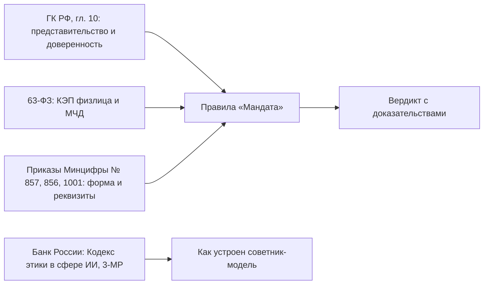

# Нормативная база

Какие нормы действуют на 17 ноября 2026 года, какие вступят позже и в каких правилах «Мандата» они отражены. Это рабочая сводка команды, а не юридическое заключение: каждую строку перед пилотом проверяет юрист банка, после чего правила переходят из `draft` в `approved`.

Какая норма стоит за каким правилом и насколько глубоко прочитан её источник — в [трассировке норм](legal/TRACEABILITY.md).

Уверенность: **высокая** — сверено с первоисточником (pravo.gov.ru, kremlin.ru, cbr.ru, текст кодекса в КонсультантПлюс или Гаранте) 13.10.2026; **средняя** — только профильные источники; **не проверено** — так и написано в строке.

## Сводная таблица

| Акт | Сроки | Суть | В «Мандате» | Уверенность |
|---|---|---|---|---|
| 63-ФЗ в ред. 476-ФЗ | МЧД обязательна с 01.09.2024 | представитель юрлица подписывает своей КЭП физлица вместе с МЧД | основа продукта (R-FMT-001, R-SIG-001) | средняя |
| Приказ Минцифры № 857 от 18.08.2021 | с 01.03.2022 до 01.03.2028 (п. 3) | единые требования к формам доверенностей; п. 2 пп. 3 — КПП доверителя и СНИЛС лица, действующего без доверенности | реквизиты (R-FMT-002, R-FMT-003, R-ID-003, R-ID-004, R-COV-001); правила на нём после 01.03.2028 — на разбор до пересверки ([ADR-010](adr/ADR-010-norm-validity.md)) | высокая: текст прочитан по официальному опубликованию 17.11.2026 ([0001202110080020](https://publication.pravo.gov.ru/document/0001202110080020)) |
| Приказ Минцифры № 856 от 18.08.2021 | с 01.03.2022 до 01.03.2028 (п. 3) | порядок формирования и актуализации классификатора полномочий | откуда брать коды вместо `SYN-…` (R-COV-001, R-COV-002); после 01.03.2028 — на разбор до пересверки | высокая: текст прочитан по официальному опубликованию 17.11.2026 ([0001202110080021](https://publication.pravo.gov.ru/document/0001202110080021)) |
| Приказ Минцифры № 1001 от 05.11.2025 | зарегистрирован Минюстом 20.01.2026 № 84990; официальное опубликование / размещение 21.01.2026 (consultant); текст в «Российской газете» — 22.01.2026; в силе с 01.02.2026¹ | паспорт представителя не обязателен, нужны ФИО, дата рождения, СНИЛС и ИНН; добавлены наименование полномочия рядом с кодом, полное наименование доверителя и сведения о руководителе филиала. КПП доверителя и СНИЛС руководителя требовались и раньше — с 01.03.2022 (№ 857, п. 2 пп. 3) | R-ID-003, R-FMT-003, R-ID-004 | высокая |
| Реестр МЧД ФНС: поиск по трём параметрам | с 01.03.2026 | МЧД выдаётся по номеру, ИНН доверителя и ИНН представителя; поиск только по номеру отключён | `PoaRegistryQueryPort`: «Мандат» передаёт все три параметра | средняя (1c-ant.ru, по выдаче поиска; первоисточник ФНС не найден) |
| 315-ФЗ от 04.08.2026 (новая ч. 1 ст. 17.5 63-ФЗ) | опубл. 04.08.2026 (Госдума 21.07, СФ 24.07), в силе с **01.09.2027** (ст. 2), переходных положений для ранее выданных доверенностей нет | доверенность представляется «в машиночитаемом виде в соответствии с единой формой доверенности, формируемой и размещаемой уполномоченным федеральным органом на едином портале государственных и муниципальных услуг»; дополнительные формы — операторы ГИС, Банк России (для доверенностей участников финансового рынка), ФНП (для нотариальных); все формы — по единым требованиям, полномочия — по классификатору (ст. 17.1). Новая ред. п. 2 ч. 1 ст. 17.2: МЧД подписывает КЭП юрлица, КЭП лица с правом передоверия или КЭП нотариуса; при передоверии — и исходная доверенность | R-FMT-002 с 01.09.2027 принимает только формы из списка банка (`forms_after_unified`), пока список пуст — «на разбор»; ранее выданные МЧД — по прежним правилам. Международные организации как доверители не моделируются ([LIMITS](../LIMITS.md)). План — [MIGRATION-315-FZ-R-FMT-001.md](MIGRATION_315_FZ.md), слот формы ЦБ — [ADR-008](adr/ADR-008-formats-and-classifier.md) | высокая: текст прочитан по официальному опубликованию 17.11.2026 ([0001202608040021](https://publication.pravo.gov.ru/document/0001202608040021)) |
| 304-ФЗ от 31.07.2025 | в целом с 01.03.2026, отдельные статьи в другие даты; когда вступает статья об изменениях 63-ФЗ — не проверено | меняет порядок аккредитации удостоверяющих центров (ст. 16 63-ФЗ) | правила не затрагивает | средняя |
| ГК РФ, ст. 186, 191, 192 | действует | без срока доверенность действует год; срок течёт со следующего дня и истекает в то же число следующего года | R-TERM-001, R-TERM-002; про 29 февраля — [LEGAL_REVIEW](LEGAL_REVIEW.md#3-доверенность-от-29-февраля) | высокая |
| ГК РФ, ст. 187 | действует | передоверие — если разрешено доверенностью (п. 1); от юрлица без нотариуса (п. 3); срок не длиннее основной (п. 4); последующее передоверие — только если разрешено (п. 7) | R-SUB-001…005, R-SUB-007…010 | высокая |
| ГК РФ, ст. 188 | действует | закрытый перечень оснований прекращения, в том числе банкротство с утратой права выдавать доверенности (подп. 7 п. 1); с основной доверенностью теряет силу передоверие (п. 3) | смена руководителя — не основание (R-EIO-002), R-EIO-004, R-SUB-006 | высокая |
| ГК РФ, ст. 188.1 | действует | безотзывная доверенность | R-FMT-004 | высокая для нормы, средняя для признаков формата |
| ГК РФ, ст. 189 | действует | сделка с третьим лицом, не знавшим об отмене, сохраняет силу (п. 2) | время каждой проверки реестра пишется в журнал | высокая |
| 115-ФЗ, ст. 7, п. 1, пп. 1; Положение Банка России 499-П | действует | до приёма на обслуживание банк идентифицирует представителя клиента и получает сведения о документе-основании: номер, дата выдачи, срок действия | таблица «Документы, подтверждающие полномочия» в карточке и `chain.documents` в отчёте ([тест](../tests/test_kyc_documents.py)); сама идентификация (паспорт, ЕСИА/ЕБС) за банком | средняя: текст прочитан 20.11.2026 на legalacts.ru (ред. от 28.06.2024): единоличный исполнительный орган — тоже представитель клиента (п. 1.1); наименование, дата выдачи, срок действия и номер документа полномочий (приложение 1, п. 1.17); обновление сведений до операции, если клиент пришёл её провести (п. 1.6) |
| Инструкция Банка России № 204-И от 30.06.2021 (ред. от 27.12.2024), счета | действует | банк располагает документами о полномочиях представителей, в том числе распоряжающихся средствами с аналогом собственноручной подписи, и сведениями о лицах с правом подписи (п. 3.2, 4.3); право подписи кроме единоличного исполнительного органа — по распорядительному акту или доверенности (п. 4.4); при сомнении в актуальности сведений — все доступные меры по обновлению (п. 4.3); карточка с образцами подписей нужна только для бумажных распоряжений (п. 5.1) | событие смены руководителя (`EIO_CHANGED`) — повод для такого сомнения; «Мандат» даёт банку данные для обновления, а сведения в банке обновляет сам банк | средняя: главы 3–5 прочитаны 20.11.2026 в КонсультантПлюс, главы 1, 2 и 6–9 — нет |
| Положение Банка России 821-П в ред. Указания 7220-У | 821-П с 01.04.2024 (заменило 719-П), изменения 7220-У с 01.10.2026 | защита информации при переводах денежных средств | ядро не переводит деньги; в пилоте — контур банка и СКЗИ ([KEYS](KEYS.md)) | средняя |
| Положение Банка России 851-П, ГОСТ Р 57580.1-2017 | 851-П от 30.01.2025 вместо 683-П | базовый состав мер защиты информации кредитной организации | соответствие не заявляется; меры стенда перечислены в [THREAT_MODEL](THREAT_MODEL.md) | средняя |
| Кодекс этики в сфере ИИ на финансовом рынке | информационное письмо Банка России от 09.07.2025 № ИН-016-13/91, рекомендательный | человекоцентричность, справедливость, прозрачность, безопасность, управление рисками; клиент может обратиться к человеку | [ADR-001](adr/ADR-001-verdict-ownership.md), `appeal`, [AI_RISKS](AI_RISKS.md) | высокая |
| Присоединение ВТБ к Кодексу | 21.08.2026 | меморандум подписан | довод для жюри | средняя: только CNews |
| Методические рекомендации Банка России № 3-МР | 16.06.2026, рекомендательные | ИБ при применении ИИ, подтверждение человеком для операций высокого риска | матрица рисков в [AI_RISKS](AI_RISKS.md) | высокая для реквизитов; полный текст не читали |
| 161-ФЗ и приказ Банка России от 05.11.2025 № ОД-2506 | с 01.01.2026; 12-й признак — с 01.03.2026 | признаков перевода без согласия клиента стало 12 вместо 6; 12-й — получатель есть в государственной информационной системе противодействия правонарушениям с использованием ИКТ | сигнал «смена реквизитов + новый получатель» в мониторинге, без связи с ГИС на стенде | высокая |
| 243-ФЗ от 26.07.2026 о технологиях ИИ | в силе с 01.09.2026; п. 3–5 ч. 2 ст. 5, ч. 2–5 ст. 6, ст. 8–10 — с **01.03.2027** (ч. 2 ст. 13) | случаи, когда допускаются только суверенные или национальные большие фундаментальные модели, устанавливаются по п. 3 ч. 2 ст. 5; на информационные системы, где модели применялись до вступления этого пункта, ограничение распространяется не ранее 01.09.2032 (ч. 3 ст. 13). Ст. 9 — информационное предупреждение о применении ИИ для аудио- и визуальных материалов; ст. 10 — уведомление пользователя о правах на результаты | провайдер модели сменный ([ADR-005](adr/ADR-005-on-prem-models.md)); подсказка модели в отчёте помечена справкой «модель предлагает…; решение — за правилами и сотрудником» и на вердикт не влияет | высокая: текст прочитан по официальному опубликованию 17.11.2026 ([0001202607260003](https://publication.pravo.gov.ru/document/0001202607260003)) |
| Приказ ФСТЭК № 117 от 11.04.2025 | в силе с 01.03.2026, заменил приказ № 17 | защита информации в ГИС, есть блок про ИИ | банку напрямую не обязателен, служит чек-листом | высокая для дат |
| 253-ФЗ от 26.07.2026 (реформа 127-ФЗ о банкротстве) | в силе через год после опубликования 26.07.2026, то есть с **27.07.2027**; отдельные пункты — с 01.01.2028, 01.01.2030, 30.03.2030 (ст. 11); дела, начатые раньше, ведутся по прежней редакции до конца текущей процедуры | первой процедурой для юрлица становится реструктуризация долгов: «органы управления должника осуществляют свои полномочия с ограничениями», план может передать полномочия руководителя арбитражному управляющему | R-EIO-004: с 27.07.2027 реструктуризация долгов юрлица — «на разбор» с пояснением о плане (параметр `org_debt_restructuring_from`), до даты — противоречие в сведениях | высокая: текст прочитан 17.11.2026 ([0001202607260034](https://publication.pravo.gov.ru/document/0001202607260034)) |
| 265-ФЗ от 26.07.2026 (ст. 12 152-ФЗ, трансграничная передача ПДн) | в силе с опубликования; ст. 2 — с 01.09.2027 | перечень государств с адекватной защитой ПДн — по Конвенции Совета Европы и мерам защиты | данные клиента не покидают контур банка, трансграничной передачи нет | высокая: текст прочитан 17.11.2026 ([0001202607260024](https://publication.pravo.gov.ru/document/0001202607260024)) |
| 254-ФЗ от 26.07.2026 (ст. 11 161-ФЗ) | с 01.09.2027 | банки раскрывают условия переводов, в том числе через СБП, и электронных средств платежа | не влияет на проверку полномочий | высокая: текст прочитан 17.11.2026 ([0001202607260013](https://publication.pravo.gov.ru/document/0001202607260013)) |
| Поправки 115-ФЗ: 461-ФЗ, 462-ФЗ, 479-ФЗ (15.12.2025), 522-ФЗ (29.12.2025), 44-ФЗ (20.02.2026) | 461-ФЗ — с 01.09.2026; части 462-ФЗ — через 90 и 180 дней после 15.12.2025; остальное — с опубликования или через десять дней | платёжные агрегаторы, данные СБП для Росфинмониторинга, контроль сделок с недвижимостью от 5 млн ₽, выгодоприобретатели по пенсионным договорам | порядок идентификации представителя юрлица и проверки его полномочий не меняют; R-ID-003 по-прежнему ссылается на ст. 7 и приказ № 74 | высокая: тексты прочитаны 17.11.2026 ([0001202512150026](https://publication.pravo.gov.ru/document/0001202512150026), [0001202512150027](https://publication.pravo.gov.ru/document/0001202512150027), [0001202512150044](https://publication.pravo.gov.ru/document/0001202512150044), [0001202512290010](https://publication.pravo.gov.ru/document/0001202512290010), [0001202602200065](https://publication.pravo.gov.ru/document/0001202602200065)) |
| 568-ФЗ, 569-ФЗ от 29.12.2025 (149-ФЗ), 514-ФЗ от 28.12.2025 (ООО) | 568-ФЗ — с 01.09.2026; остальное — с опубликования | доменные имена и идентификация через ЕСИА; действительная стоимость доли в ООО | не влияют на проверку полномочий | высокая: тексты прочитаны 17.11.2026 |

| ГК РФ, ст. 847 «Порядок распоряжения денежными средствами, находящимися на счете» | в силе | права лиц, которые распоряжаются деньгами от имени клиента, клиент удостоверяет документами по закону, банковским правилам и договору (п. 1); договор может предусматривать удостоверение аналогами собственноручной подписи, кодами, паролями и иными средствами (п. 4) | основание проверки кейса; допуск операции станет частью способа удостоверения прав, только если его назовёт договор счёта или правила ДБО — вопрос юристу | средняя: текст статьи сверен 20.11.2026 по legalacts.ru, редакция ГК с изменениями от 09.06.2026 |
| Положение Банка России № 787-П от 12.01.2022 (ред. от 06.10.2023), операционная надёжность | в силе | допустимое время простоя и деградации технологических процессов, инциденты и информирование Банка России, тестирование, внешние подрядчики и технологическая зависимость | допуск перед платежом — звено процесса ДБО: нужен режим деградации и второй узел ([пилот](PILOT.md#что-может-пойти-не-так)) | средняя: п. 1–11 сверены 20.11.2026 по legalacts.ru, числа приложения не прочитаны |
| Положение Банка России № 716-П от 08.04.2020, операционный риск | в силе | риск информационной безопасности и риск информационных систем — виды операционного риска (п. 1.4) | инциденты «Мандата» попадают в учёт операционного риска банка | средняя: по ответам Банка России на вопросы (cbr.ru) |

¹ Дата «21.01.2026» — день размещения в справочно-правовых системах / официального опубликования по реквизитам; «22.01.2026» — дата выхода текста в «Российской газете» (rg.ru). Для сроков вступления в силу ориентир — 01.02.2026: своей даты вступления текст приказа не задаёт, поэтому он вступает в силу по истечении десяти дней после дня официального опубликования 21.01.2026 (п. 12 Указа Президента РФ от 23.05.1996 № 763). Вместе с № 857 изменения утрачивают силу 01.03.2028.

## Календарь изменений

Даты — по текстам законов на publication.pravo.gov.ru, прочитанным 17.11.2026 (перечень федеральных законов портала с 31.07.2025 по 17.11.2026 просмотрен по названиям). Каталог актов, на которых стоят правила, лежит в пакете правил (`norms` в `src/mandat/data/rules.json`); `mandat law-calendar --on ГГГГ-ММ-ДД --days N` показывает, что вступает в силу и что утрачивает её, и возвращает код 1, если на дату есть акт, утративший силу.

| Дата | Что меняется | Что делает «Мандат» |
|---|---|---|
| 01.09.2026 | 243-ФЗ об ИИ вступает в силу | модель — только подсказка, провайдер сменный |
| 01.03.2027 | 243-ФЗ: ст. 5 п. 3–5 ч. 2, ст. 6, 8–10 | без изменений: модель не принимает решений |
| 27.07.2027 | 253-ФЗ: реструктуризация долгов юрлица | R-EIO-004 объясняет процедуру и отправляет на разбор |
| 01.09.2027 | 315-ФЗ: единая форма доверенности на ЕПГУ; 254-ФЗ; ст. 2 265-ФЗ | R-FMT-002 принимает только формы из списка банка, МЧД до даты — по прежним правилам |
| 01.03.2028 | приказы Минцифры № 856 и № 857 утрачивают силу (п. 3 каждого) | правила на них «подтверждено» не дают, пока пакет не пересверят с новыми требованиями |
| 01.09.2032 | 243-ФЗ, ч. 3 ст. 13: суверенные модели для систем, работавших до вступления п. 3 ч. 2 ст. 5 | сменить провайдера модели, если банковская сфера попадёт в перечень случаев |

## За рубежом

Проверку полномочия представителя требуют и международные стандарты. FATF (Рекомендация 10, пояснительная записка, п. 4): проверить, что лицо, действующее от имени клиента, уполномочено (M-12). В ЕС с 10.07.2027 — Регламент 2024/1624, ст. 22; проект RTS AMLA требует проверить существование и объём полномочия (M-13). Директива (ЕС) 2025/25 вводит выписку о компании ЕС, где видно, действуют ли представители по одному или совместно, и цифровую доверенность ЕС; страны применяют нормы с 31.07.2028 (M-14). Это ориентир, а не нормы для российского банка. Источники и что из этого следует для правил — в [срезе 20.10](BANK_PRACTICE.md).

## Смена руководителя

Смены руководителя нет в закрытом перечне п. 1 ст. 188 ГК РФ. ФНС разъясняет, что выданные раньше МЧД действуют, пока новый руководитель их не отменит; в 2026 году то же пишут Диадок и Saby ([SOURCES](SOURCES.md)). Решение — [ADR-002](adr/ADR-002-director-change.md):

| Ситуация | Что делает R-EIO-002 | Демо-кейс |
|---|---|---|
| МЧД прежнего руководителя не отменена, смена давняя | сигнал «справка»; итог решают остальные проверки | `10_old_director_poa` (на разбор: устав не разобран), `14_old_director_charter_cleared` (подтверждено) |
| Смена свежая (до 30 дней) или операция высокого риска | на разбор | `05_director_changed` |
| Основная доверенность отменена | опровергнуто по R-SUB-006 | `11_parent_revoked` |

## Банкротство

Таблица собрана по тексту закона и опубликованной практике. Заключения юриста по ней нет, вопросы к нему — в [LEGAL_REVIEW](LEGAL_REVIEW.md#1-банкротство-доверителя-и-представителя).

[Подп. 7 п. 1 ст. 188 ГК РФ](https://www.consultant.ru/document/cons_doc_LAW_5142/c511d2a3c68c7a42497babc32771904550debd21/) прекращает доверенность, если в отношении представляемого или представителя введена «такая процедура банкротства, при которой соответствующее лицо утрачивает право самостоятельно выдавать доверенности». Сам закон процедуры не перечисляет, поэтому смотрим, что каждая делает с полномочиями органов управления. Для внешнего управления и конкурсного производства это прямо сказано в [п. 130 постановления Пленума ВС РФ от 23.06.2015 № 25](https://www.consultant.ru/document/cons_doc_LAW_181602/be43b61adaf90955d90a644ad4cbb68c3dfd5d7c/) (текст сверен 13.10.2026).

Правило R-EIO-004 читает статус через порт `BankruptcyPort` отдельно для доверителя (организация) и представителя (гражданин). R-BNK-001 отдельно фиксирует, что ответ источника по обеим сторонам получен и распознан (отсутствие ответа ≠ «банкротства нет»).

| Процедура (`значение`) | Что происходит с полномочиями | Вердикт | Норма |
|---|---|---|---|
| Наблюдение (`observation`) | руководитель не отстраняется, крупные сделки, займы, поручительства только с письменного согласия временного управляющего | на разбор | [ст. 64 127-ФЗ](https://rulaws.ru/laws/Federalnyy-zakon-ot-26.10.2002-N-127-FZ/Statya-64/) |
| Финансовое оздоровление (`financial_recovery`) | органы управления работают с ограничениями, суд может отстранить руководителя | на разбор | [ст. 82 127-ФЗ](https://rulaws.ru/laws/Federalnyy-zakon-ot-26.10.2002-N-127-FZ/Statya-82/) |
| Внешнее управление (`external_management`) | полномочия руководителя прекращаются, управление переходит к внешнему управляющему | опровергает | [ст. 94 127-ФЗ](https://rulaws.ru/laws/Federalnyy-zakon-ot-26.10.2002-N-127-FZ/Statya-94/), подп. 7 п. 1 ст. 188 ГК РФ |
| Конкурсное производство (`bankruptcy_proceedings`) | прекращаются полномочия руководителя и органов управления | опровергает | [п. 2 ст. 126 127-ФЗ](https://rulaws.ru/laws/Federalnyy-zakon-ot-26.10.2002-N-127-FZ/Statya-126/), подп. 7 п. 1 ст. 188 ГК РФ |
| Мировое соглашение (`settlement`) | производство по делу прекращается, полномочия управляющего прекращаются | на разбор: сверить дату доверенности с периодами внешнего управления и конкурсного производства | [ст. 159 127-ФЗ](https://rulaws.ru/laws/Federalnyy-zakon-ot-26.10.2002-N-127-FZ/Statya-159/) |
| Реструктуризация долгов гражданина (`debt_restructuring`) | ряд сделок только с согласия финансового управляющего, операции по счетам ограничены | на разбор | [ст. 213.11 127-ФЗ](https://rulaws.ru/laws/Federalnyy-zakon-ot-26.10.2002-N-127-FZ/Statya-213.11/) |
| Реструктуризация долгов юрлица (`debt_restructuring`, с 27.07.2027 по 253-ФЗ) | органы управления должника действуют с ограничениями плана реструктуризации; план может передать полномочия руководителя арбитражному управляющему | на разбор | 127-ФЗ в ред. 253-ФЗ |
| Реализация имущества гражданина (`property_sale`) | имуществом распоряжается финансовый управляющий. По практике право выдавать доверенности гражданин сохраняет, подп. 7 к нему не применяют | на разбор | ст. 213.25 127-ФЗ; [обзор практики](https://oaufenix.ru/news/1747/) (дело А57-13952/2018, определение ВС № 306-ЭС21-3432(6) от 20.12.2022) |
| Процедура не того вида лица (например, конкурсное производство у гражданина) | сведения противоречат друг другу | на разбор | — |
| `none` или данных нет | — | молчит. Нет данных значит «не проверено», а не «банкротства нет» | — |

Отдельно стоит помнить п. 3 ст. 188: вместе с основной доверенностью теряет силу и передоверие (R-SUB-006). В стенде сведения берутся из поля `bankruptcy` манифеста кейса, живой ЕФРСБ не опрашивается. Демо-кейс `13_bankruptcy`: доверитель в конкурсном производстве.

## Формат МЧД и классификатор

Пути полей, значения признаков и что из них сверено — в [FORMAT_NOTES](FORMAT_NOTES.md). Банковских кодов полномочий в открытых источниках мы не нашли, поэтому коды синтетические, а настоящий снимок собирается из выгрузки ЕСНСИ ([ADR-008](adr/ADR-008-formats-and-classifier.md)). По данным ФНС от 27.07.2026, в распределённом реестре зарегистрировано 5 млн МЧД.

## Что подтвердить не удалось

- Изменения Инструкции № 204-И и Положения № 499-П позже редакций от 27.12.2024 и 28.06.2024: на страницах КонсультантПлюс и legalacts.ru на 20.11.2026 их нет, официальная публикация не сверена.
- Отдельный запрет на изменения в ЕГРЮЛ без личного участия. Подтверждены только заявление о недостоверности (форма Р34001) и запреты суда или приставов.
- Других поправок 152-ФЗ, кроме 265-ФЗ, в названиях федеральных законов с 31.07.2025 по 17.11.2026 нет; поправки в другие акты, затрагивающие ПДн, по названию могли не попасть в выборку.
- Обязателен ли срок действия МЧД после приказа № 1001: так пишут коммерческие источники; в XSD формата 003 срок обязателен.
- Дата вступления в силу статьи 304-ФЗ об изменениях 63-ФЗ.

Ссылки — [SOURCES](SOURCES.md).
