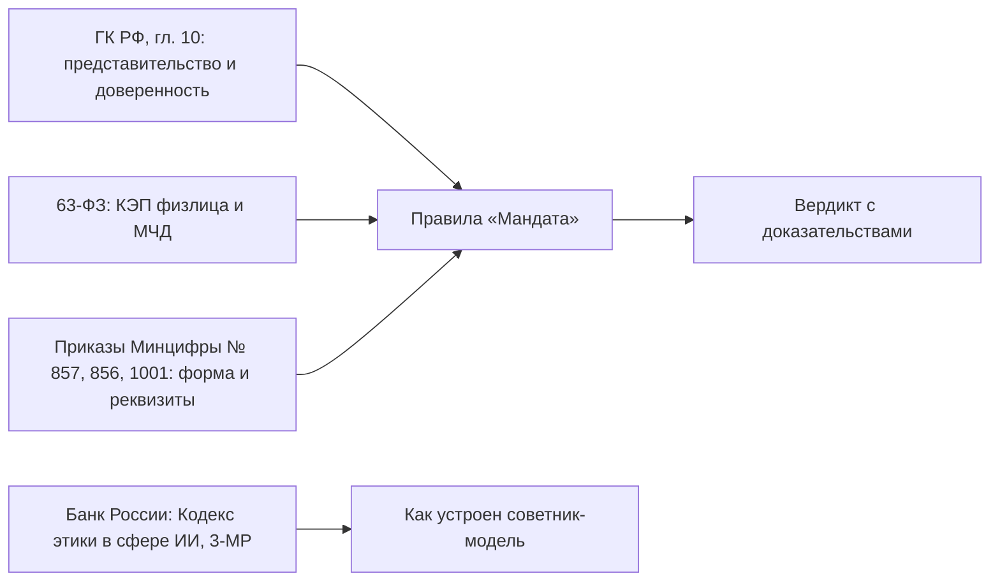

# Нормативная база

Какие нормы действуют на октябрь 2026 года и в каких правилах «Мандата» они отражены. Это рабочая сводка команды, а не юридическое заключение: каждую строку перед пилотом проверяет юрист банка, после чего правила переходят из `draft` в `approved`.

Уверенность: **высокая** — сверено с первоисточником (pravo.gov.ru, kremlin.ru, cbr.ru, текст кодекса в КонсультантПлюс или Гаранте) 13.10.2026; **средняя** — только профильные источники; **не проверено** — так и написано в строке.

## Сводная таблица

| Акт | Сроки | Суть | В «Мандате» | Уверенность |
|---|---|---|---|---|
| 63-ФЗ в ред. 476-ФЗ | МЧД обязательна с 01.09.2024 | представитель юрлица подписывает своей КЭП физлица вместе с МЧД | основа продукта (R-FMT-001, R-SIG-001) | средняя |
| Приказ Минцифры № 857 от 18.08.2021 | действует | единые требования к формам доверенностей | реквизиты (R-FMT-002, R-FMT-003) | средняя |
| Приказ Минцифры № 856 от 18.08.2021 | действует | основа классификатора полномочий | откуда брать коды вместо `SYN-…` (R-COV-001, R-COV-002) | средняя |
| Приказ Минцифры № 1001 от 05.11.2025 | зарегистрирован Минюстом 20.01.2026 № 84990, опубликован 21.01.2026, в силе с 01.02.2026 | паспорт представителя не обязателен, нужны ФИО, дата рождения, СНИЛС и ИНН; добавлены КПП и СНИЛС руководителя доверителя и наименование полномочия рядом с кодом | R-ID-003, R-FMT-003, R-ID-004 | высокая |
| 315-ФЗ от 04.08.2026 | Госдума 21.07.2026, Совет Федерации 24.07.2026, в силе с 01.09.2027 | единая форма МЧД на Госуслугах становится универсальной; дополнительные формы — Банка России для участников финансового рынка и Федеральной нотариальной палаты | адаптеры форматов, слот под форму Банка России ([ADR-008](adr/ADR-008-formats-and-classifier.md)) | высокая |
| 304-ФЗ от 31.07.2025 | в целом с 01.03.2026, отдельные статьи в другие даты; когда вступает статья об изменениях 63-ФЗ — не проверено | меняет порядок аккредитации удостоверяющих центров (ст. 16 63-ФЗ) | правила не затрагивает | средняя |
| ГК РФ, ст. 186, 191, 192 | действует | без срока доверенность действует год; срок течёт со следующего дня и истекает в то же число следующего года | R-TERM-001, R-TERM-002; про 29 февраля — [LEGAL_REVIEW](LEGAL_REVIEW.md#3-доверенность-от-29-февраля) | высокая |
| ГК РФ, ст. 187 | действует | передоверие — если разрешено доверенностью (п. 1); от юрлица без нотариуса (п. 3); срок не длиннее основной (п. 4); последующее передоверие — только если разрешено (п. 7) | R-SUB-001…003, R-SUB-010 | высокая |
| ГК РФ, ст. 188 | действует | закрытый перечень оснований прекращения, в том числе банкротство с утратой права выдавать доверенности (подп. 7 п. 1); с основной доверенностью теряет силу передоверие (п. 3) | смена руководителя — не основание (R-EIO-002), R-EIO-004, R-SUB-006 | высокая |
| ГК РФ, ст. 188.1 | действует | безотзывная доверенность | R-FMT-004 | высокая для нормы, средняя для признаков формата |
| ГК РФ, ст. 189 | действует | сделка с третьим лицом, не знавшим об отмене, сохраняет силу (п. 2) | время каждой проверки реестра пишется в журнал | высокая |
| Кодекс этики в сфере ИИ на финансовом рынке | информационное письмо Банка России от 09.07.2025 № ИН-016-13/91, рекомендательный | человекоцентричность, справедливость, прозрачность, безопасность, управление рисками; клиент может обратиться к человеку | [ADR-001](adr/ADR-001-verdict-ownership.md), `appeal`, [AI_RISKS](AI_RISKS.md) | высокая |
| Присоединение ВТБ к Кодексу | 21.08.2026 | меморандум подписан | довод для жюри | средняя: только CNews |
| Методические рекомендации Банка России № 3-МР | 16.06.2026, рекомендательные | ИБ при применении ИИ, подтверждение человеком для операций высокого риска | матрица рисков в [AI_RISKS](AI_RISKS.md) | высокая для реквизитов; полный текст не читали |
| 161-ФЗ и приказ Банка России от 05.11.2025 № ОД-2506 | с 01.01.2026; 12-й признак — с 01.03.2026 | признаков перевода без согласия клиента стало 12 вместо 6; 12-й — получатель есть в государственной информационной системе противодействия правонарушениям с использованием ИКТ | сигнал «смена реквизитов + новый получатель» в мониторинге, без связи с ГИС на стенде | высокая |
| 243-ФЗ от 26.07.2026 о технологиях ИИ | Госдума 08.07.2026, Совет Федерации 17.07.2026; в силе с 01.09.2026, отдельные нормы с 01.03.2027 (ст. 13) | ст. 5 (п. 3 ч. 2): случаи, когда допускаются только суверенные или национальные модели, устанавливает Правительство; в банковской сфере — по согласованию с Банком России; пункт вступает в силу с 01.03.2027 (ч. 2 ст. 13; kremlin.ru, Российская газета) | провайдер модели сменный ([ADR-005](adr/ADR-005-on-prem-models.md)) | высокая для реквизитов |
| Приказ ФСТЭК № 117 от 11.04.2025 | в силе с 01.03.2026, заменил приказ № 17 | защита информации в ГИС, есть блок про ИИ | банку напрямую не обязателен, служит чек-листом | высокая для дат |

## Смена руководителя

Смены руководителя нет в закрытом перечне п. 1 ст. 188 ГК РФ. ФНС разъясняет, что выданные раньше МЧД действуют, пока новый руководитель их не отменит; в 2026 году то же пишут Диадок и Saby ([SOURCES](SOURCES.md)). Решение — [ADR-002](adr/ADR-002-director-change.md):

| Ситуация | Что делает R-EIO-002 | Демо-кейс |
|---|---|---|
| МЧД прежнего руководителя не отменена, смена давняя | сигнал «справка»; итог решают остальные проверки | `10_old_director_poa` (на разбор: устав не разобран), `14_old_director_charter_cleared` (подтверждено) |
| Смена свежая (до 30 дней) или операция высокого риска | на разбор | `05_director_changed` |
| Основная доверенность отменена | опровергнуто по R-SUB-006 | `11_parent_revoked` |

## Банкротство

Таблица собрана по тексту закона и опубликованной практике. Заключения юриста по ней нет, вопросы к нему — в [LEGAL_REVIEW](LEGAL_REVIEW.md#1-банкротство-доверителя-и-представителя).

[Подп. 7 п. 1 ст. 188 ГК РФ](https://www.consultant.ru/document/cons_doc_LAW_5142/c511d2a3c68c7a42497babc32771904550debd21/) прекращает доверенность, если в отношении представляемого или представителя введена «такая процедура банкротства, при которой соответствующее лицо утрачивает право самостоятельно выдавать доверенности». Сам закон процедуры не перечисляет, поэтому смотрим, что каждая делает с полномочиями органов управления. Для внешнего управления и конкурсного производства это прямо сказано в [п. 130 постановления Пленума ВС РФ от 23.06.2015 № 25](https://www.consultant.ru/document/cons_doc_LAW_181602/be43b61adaf90955d90a644ad4cbb68c3dfd5d7c/) (текст сверен 13.10.2026).

Правило R-EIO-004 читает статус через порт `BankruptcyPort` отдельно для доверителя (организация) и представителя (гражданин).

| Процедура (`значение`) | Что происходит с полномочиями | Вердикт | Норма |
|---|---|---|---|
| Наблюдение (`observation`) | руководитель не отстраняется, крупные сделки, займы, поручительства только с письменного согласия временного управляющего | на разбор | [ст. 64 127-ФЗ](https://rulaws.ru/laws/Federalnyy-zakon-ot-26.10.2002-N-127-FZ/Statya-64/) |
| Финансовое оздоровление (`financial_recovery`) | органы управления работают с ограничениями, суд может отстранить руководителя | на разбор | [ст. 82 127-ФЗ](https://rulaws.ru/laws/Federalnyy-zakon-ot-26.10.2002-N-127-FZ/Statya-82/) |
| Внешнее управление (`external_management`) | полномочия руководителя прекращаются, управление переходит к внешнему управляющему | опровергает | [ст. 94 127-ФЗ](https://rulaws.ru/laws/Federalnyy-zakon-ot-26.10.2002-N-127-FZ/Statya-94/), подп. 7 п. 1 ст. 188 ГК РФ |
| Конкурсное производство (`bankruptcy_proceedings`) | прекращаются полномочия руководителя и органов управления | опровергает | [п. 2 ст. 126 127-ФЗ](https://rulaws.ru/laws/Federalnyy-zakon-ot-26.10.2002-N-127-FZ/Statya-126/), подп. 7 п. 1 ст. 188 ГК РФ |
| Мировое соглашение (`settlement`) | производство по делу прекращается, полномочия управляющего прекращаются | на разбор: сверить дату доверенности с периодами внешнего управления и конкурсного производства | [ст. 159 127-ФЗ](https://rulaws.ru/laws/Federalnyy-zakon-ot-26.10.2002-N-127-FZ/Statya-159/) |
| Реструктуризация долгов гражданина (`debt_restructuring`) | ряд сделок только с согласия финансового управляющего, операции по счетам ограничены | на разбор | [ст. 213.11 127-ФЗ](https://rulaws.ru/laws/Federalnyy-zakon-ot-26.10.2002-N-127-FZ/Statya-213.11/) |
| Реализация имущества гражданина (`property_sale`) | имуществом распоряжается финансовый управляющий. По практике право выдавать доверенности гражданин сохраняет, подп. 7 к нему не применяют | на разбор | ст. 213.25 127-ФЗ; [обзор практики](https://oaufenix.ru/news/1747/) (дело А57-13952/2018, определение ВС № 306-ЭС21-3432(6) от 20.12.2022) |
| Процедура не того вида лица (например, конкурсное производство у гражданина) | сведения противоречат друг другу | на разбор | — |
| `none` или данных нет | — | молчит. Нет данных значит «не проверено», а не «банкротства нет» | — |

Отдельно стоит помнить п. 3 ст. 188: вместе с основной доверенностью теряет силу и передоверие (R-SUB-006). В стенде сведения берутся из поля `bankruptcy` манифеста кейса, живой ЕФРСБ не опрашивается. Демо-кейс `13_bankruptcy`: доверитель в конкурсном производстве.

## Формат МЧД и классификатор

Пути полей, значения признаков и что из них сверено — в [FORMAT_NOTES](FORMAT_NOTES.md). Банковских кодов полномочий в открытых источниках мы не нашли, поэтому коды синтетические, а настоящий снимок собирается из выгрузки ЕСНСИ ([ADR-008](adr/ADR-008-formats-and-classifier.md)). По данным ФНС от 27.07.2026, в распределённом реестре зарегистрировано 5 млн МЧД.

## Что подтвердить не удалось

- Изменения требований к банкам при смене руководителя и лиц с правом подписи в 2025–2026 годах (Инструкция № 204-И, Положение № 499-П).
- Отдельный запрет на изменения в ЕГРЮЛ без личного участия. Подтверждены только заявление о недостоверности (форма Р34001) и запреты суда или приставов.
- Изменения 152-ФЗ в 2025–2026 годах.
- Обязателен ли срок действия МЧД после приказа № 1001: так пишут коммерческие источники; в XSD формата 003 срок обязателен.
- Дата вступления в силу статьи 304-ФЗ об изменениях 63-ФЗ.

Ссылки — [SOURCES](SOURCES.md).
